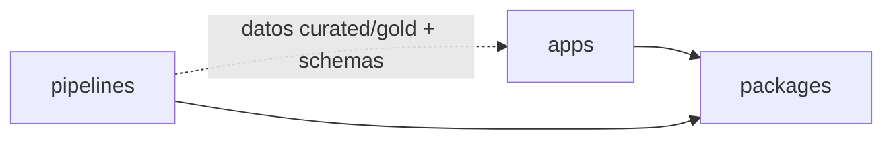

# Arquitectura y patrón de carpetas

VIGÍA es un **monorepo organizado por unidad desplegable**. Cada tipo de trabajo tiene su contenedor: ingesta y procesamiento de datos, aplicaciones, librerías compartidas y herramientas. Cada subcarpeta de un contenedor es un **módulo** autocontenido, con su `MODULE.md`, sus dependencias y sus tests. Así, el equipo de datos y el de producto trabajan en paralelo sin pisarse.

```
apps/                 Lo que usa una persona: interfaces y servicios
  web/                PWA a bordo (registro diario, figura humana, alertas, vista de tierra)
  api/                API FastAPI a bordo, SQLite local, gold verificado y puente del reloj
pipelines/            Ingesta y procesamiento de datos, de un script a big data
  datalake/           Ingesta GOES, DONKI, RadLab y EDA → zonas raw y curated
  reanclaje/          Rejilla, paneles gold, simulación reproducible y trayectoria de la demo
packages/             Librerías compartidas, sin efectos secundarios
  engine/             Motor híbrido A/B/C y descomposición de series en TypeScript puro
  schemas/            Contratos JSON Schema, perfiles, vocabulario y fichas
  i18n/               traducciones: español principal, inglés secundario (Python y TS)
tools/                Herramientas del equipo, no van al producto
  contextgen/         Genera el contexto para IA (MODULE.md, docs/context)
  verificacion/       Suites, tipado/build, inventario y ensayo de recuperación en Chrome
docs/                 Arquitectura, setup y contexto generado
documentacion/        Informe técnico del reto (entregable)
```

El índice completo y actualizado de módulos está en [context/INDEX.md](context/INDEX.md). Esta estructura describe la implementación actual; los trabajos futuros están en [PLAN-MAESTRO.md](PLAN-MAESTRO.md).

## Regla de dependencias



1. `apps/` y `pipelines/` pueden importar de `packages/`.
2. `packages/` **no** importa de `apps/` ni de `pipelines/`, y no hace IO (red, disco o almacenamiento del navegador). Recibe datos y devuelve datos.
3. `apps/` **no** importa código de `pipelines/`, ni al revés. Se comunican solo por **datos**: lo que un pipeline publica (zona curated o gold, o un JSON exportado) con la forma que define `packages/schemas`.
4. Un módulo no importa de otro módulo del mismo contenedor. Si dos lo necesitan, ese código sube a `packages/`.
5. `tools/` no es dependencia de nadie.

El motivo de la regla 3: el informe (§4.1) separa la preparación de datos, que ocurre antes de la misión, del dispositivo de a bordo, que funciona sin conexión. Si la app importara un pipeline, arrastraría dependencias de servidor al navegador.

## `pipelines/`: datos, de un script a big data

Cada pipeline sigue el patrón **medallón**:

| Zona | Nombre en el repo | Qué contiene | Regla |
| --- | --- | --- | --- |
| Bronce | `raw/` | Respuesta original de la fuente | Inmutable: nunca se sobrescribe ni se borra |
| Plata | `curated/` | Filas limpias, deduplicadas, con `t_real` en UTC | Se regenera desde bronce |
| Oro | `gold/` | Agregados listos para consumir (ventanas de misión, índices) | Lo que leen las apps |

Cada escritura queda en un **manifiesto** con fuente, URL, hora, SHA-256 y número de filas. Así cualquier dato es trazable hasta su origen. `pipelines/datalake` ya lo hace para bronce y plata.

Estructura de un pipeline:

```
pipelines/<nombre>/
  MODULE.md             propósito, puntos clave y contrato de salida
  requirements.txt      dependencias propias (el datalake no tiene: solo biblioteca estándar)
  <nombre>.py           o un paquete con extract.py / transform.py / load.py si crece
  index.py              CLI: ingest, read y lo que haga falta
  test_*.py             con fixtures pequeñas en memoria, sin red
  data/                 local e ignorado por git (DATALAKE_DIR lo cambia)
```

Reglas para pipelines:

- **Idempotente:** correr dos veces la misma ventana no duplica filas.
- **Falla cerrado:** si la estructura de la fuente cambia, se lanza un error y no se escribe nada (`EstructuraInesperada`).
- **Escalado:** primero JSON o CSV con la biblioteca estándar. Si el volumen crece, Parquet particionado por `fuente=<f>/fecha=<YYYY-MM-DD>` y Polars o DuckDB. Si no cabe en una máquina, Spark. El contrato de salida y el manifiesto no cambian; solo el motor.
- **Datos fuera de git:** los datos se guardan en `data/` (ignorado) o, en equipo, en un almacenamiento compartido apuntado con `DATALAKE_DIR`. A git solo suben las fixtures de test.
- Cada pipeline nuevo es su propio módulo (`pipelines/biometria/`, `pipelines/watch4/`…) y lee la zona curated de otro solo a través de su API pública (`read()`), nunca abriendo sus archivos directamente.

## `apps/`: front y back

**`apps/web`** usa Next.js 16 (App Router), React 19, TypeScript, Tailwind CSS 4 y three.js. Se organiza así:

```
apps/web/
  package.json
  app/[rol]/             rutas de astronauta, oficial y médico
  components/            pantallas por funcionalidad, contexto y controles compartidos
  lib/                   cliente API, adaptadores del motor, almacenamiento y sincronización
  public/                service worker, manifiesto PWA, modelo anatómico
```

Las pantallas comparten el contexto de sesión y las interfaces de `lib/`. Los estados del motor se calculan localmente; los textos salen de `packages/i18n`. El cuerpo usa un modelo anatómico 3D o una anatomía procedural; sin WebGL conserva las tarjetas y avisa de la indisponibilidad del lienzo.

**`apps/api`** es un servicio local FastAPI. `main.py` monta rutas, ciclo de vida y proxy del reloj; `gold.py` verifica hashes antes de servir artefactos; `rutas_dashboard.py` adapta historia/entorno a la web; `rutas_registro.py` publica el registro; `almacen/` contiene SQLite, migraciones y reglas de persistencia; `puente_reloj.py` recibe smart-monitor. El reloj físico y su servidor viven en otro repositorio y no son importados por la app.

La web consulta `/vigia-api`; Next reenvía al servicio local configurado en `VIGIA_API_INTERNA` al compilar. Perder Internet/Tierra, perder la API local y perder smart-monitor son fallos diferentes. El service worker conserva la carcasa y la app conserva catálogos/colas; el primer arranque sí requiere disponer de la aplicación y sus datos.

Los registros y alertas mantienen el HealthStore local por modo. Los informes tienen una bandeja persistente por misión/tripulante/modo e IDs estables; síntomas e informes son idempotentes en SQLite. La entrega sigue simulándose en la API: no hay receptor independiente en Tierra. La selección de rol en una ruta y `X-Tripulante` siguen siendo atajos de identidad; no constituyen autenticación.

La demo usa el caso sintético del viaje a Marte de 259 días, con cronología DONKI histórica y dosis de tránsito simulada. El caso de 30 días permanece para paridad/evaluación sintética. El entorno remoto o reanclado servido en modo real es referencia; no activa recomendaciones de cabina. La dosis ambiental conserva detector y magnitud, sin convertir absorbida a equivalente ni inferir dosis personal.

## `packages/`: lógica compartida

- `packages/engine`: motor híbrido (capa A clínica, capa B de desviación personal, capa C de deriva; informe §5.1). Funciones puras con paridad Python/TypeScript; la web ejecuta este motor y la simulación Python se usa para referencias. La API almacena y sirve observaciones/alertas; no ejecuta TypeScript.
- `packages/schemas`: JSON Schema de las filas curadas (`t_real`, fuente…) y de las fichas de indicador (los seis campos del reto más la URL de la fuente). Es el contrato entre `pipelines/` y `apps/`. Si cambia, se versiona.
- `packages/i18n`: catálogos de traducción. Español principal y obligatorio; inglés secundario, que cae al español si falta. Todo texto que ve un usuario sale de aquí.

## De las capas del informe a las carpetas

| Capa (informe §4.2) | Dónde vive |
| --- | --- |
| Ingesta | `pipelines/datalake` |
| Reanclaje a la línea de tiempo de misión | `pipelines/reanclaje`, que genera la zona gold |
| Captura, presentación y decisión local | `apps/web/components`, `apps/web/lib`, `packages/engine` |
| Almacén y reglas de persistencia del servidor local | `apps/api/almacen`, rutas de la API |
| Motor híbrido | `packages/engine` |
| Fichas de indicador | `packages/schemas/fichas` y `fichas_en`, servidas por la API |
| Vista de tierra | `apps/web/app/[rol]` con rol médico; transporte local simulado |

## Convenciones

Los nombres, el idioma, i18n, git, los datos y los tests se definen en [CONVENCIONES.md](CONVENCIONES.md).

## Agregar un módulo nuevo

1. Crea `apps/<x>`, `pipelines/<x>`, `packages/<x>` o `tools/<x>` según lo que sea. Si dudas: si lo usa una persona es `apps/`; si mueve datos, `pipelines/`; si lo comparten dos módulos, `packages/`.
2. Agrega el código y los tests y haz `git add`. En el commit, el hook crea `MODULE.md` con TODOs.
3. Completa el bloque MANUAL de `MODULE.md`: propósito, puntos clave, tags y, en pipelines, el contrato de salida.
4. Si hay tests de Python (`test_*.py`), CI los corre solo. Para tests de Node, agrega el paso en `.github/workflows/context.yml`.

`contextgen --lint` avisa si aparece código fuera de estos contenedores.
