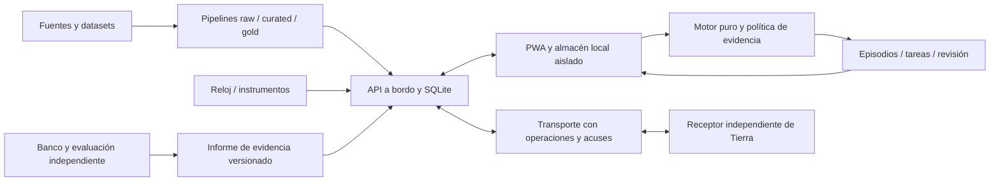

# Plan completo de implementación y validación de VIGÍA

Versión 2 · 16-nov-2026 UTC · **Plan vigente para el trabajo siguiente.**

Ejecución: [cambios implementados y aceptación T01–T44](EJECUCION-PLAN.md). T38 está excluida por solicitud del usuario. Esta lista no se interpreta como trabajo ya terminado.

Este documento reúne lo que falta construir, integrar, medir y revisar. Sustituye la secuencia futura del [plan anterior](PLAN-MAESTRO.md), que se conserva como antecedente. Una tarea escrita aquí sigue pendiente hasta que exista su evidencia de aceptación. La aprobación de este plan no es una aprobación clínica del producto.

## 1. Qué debemos agregar, explicado como producto

El objetivo es que VIGÍA complete este recorrido: **medir → comprobar evidencia → reconocer un cambio → abrir seguimiento → realizar una acción revisada → volver a medir → revisar el resultado → comunicarlo y recibir confirmación cuando corresponda**.

| Lo que falta | Qué verá o podrá hacer una persona | Por qué lo necesitamos |
| --- | --- | --- |
| Mediciones con tiempo y calidad propios | Saber cuándo, cómo y con qué se midió cada valor; conservar repeticiones y extremos. | Hoy un resumen diario puede ocultar el orden real de los hechos. |
| Detección personal mejor evaluada | Ver cambios relevantes con explicación y carga de alertas medida. | En el banco actual el motor detectó 1/60 derivas sutiles; falta investigar causas y evaluar mejoras. |
| Seguimiento completo de episodios | Tener una tarea, registrar lo realizado, remedir y conocer quién revisó/cerró el caso. | Una alerta aislada no demuestra que el problema se atendió. |
| Identidad y operación local confiables | Acceder a sus datos, conservarlos al cerrar la app y sincronizar sin mezclas o duplicados. | El selector de rol y `X-Tripulante` no proporcionan autenticación. |
| Módulos científicos acotados | Revisar sueño/recuperación, entorno aplicable y una tarea de vigilancia caracterizada; ampliar laboratorio cuando tenga una pregunta concreta. | Cada módulo debe producir una salida revisable y tener su propio método de evaluación. |
| Evidencia externa y profesional | Consultar qué revisaron especialistas, en qué versión y qué resultado obtuvo el sistema frente a alternativas. | Las simulaciones y las citas bibliográficas no prueban beneficio clínico o novedad por sí solas. |

Ejemplo de experiencia terminada: una persona registra una medida, VIGÍA explica si la evidencia basta, enlaza una desviación con un episodio, presenta la siguiente tarea del protocolo revisado, conserva la nueva medida y su hora, registra revisión y cierre, y permite comunicar una instantánea con acuse del destino. Si falta información, muestra qué falta. El caso sobrevive a un reinicio y al corte de enlace.

### 1.1 Punto de partida que se conserva

Base local inspeccionada: `cf5d53f184ea71ebf6e638d08e7ebee95f9c548c`, rama `docs/analisis-innovacion-vigia`, con cambios locales. No se consultó de nuevo el remoto para redactar este plan; debe sincronizarse antes del siguiente PR conforme a AGENTS.md.

- Ya existen PWA Next.js, API FastAPI, SQLite, registro, tendencias, cuerpo 3D/2D, alertas, informes, puente del reloj y perfiles de misión. Se amplían estos componentes.
- Ya existen motor A/B/C/contexto, ingesta GOES/DONKI/RadLab/EDA, manifiestos, trazabilidad, separaciones de referencia/escenario y parte de la recuperación sin red.
- Ya existen reconciliación de migraciones 005/006, idempotencia parcial, bandeja durable de informes y ensayo de recuperación. No reconstruirlos; completar los huecos.
- Ya existen auditoría sintética v1.1, comparadores, ablaciones, registro de afirmaciones y panel científico. La última verificación ejecutó 363 pruebas; los resultados exactos están en [VERIFICACION](VERIFICACION.md).
- El banco de 780 misiones es del mismo equipo y ya se inspeccionó: **se considera evidencia de desarrollo/exploración para la siguiente iteración**. Una semilla nueva no lo convierte en conjunto independiente.
- Durante la ampliación solicitada al redactar este plan se incorporaron **MMASH v1.0.0** (22 sujetos, 1.749.295 intervalos originales, 22 periodos de sueño) y un **día de Orion** (3.456 observaciones, cuatro instrumentos). Se publican como referencia mediante `/ciencia/datasets`. MMASH conserva los 47.599 intervalos con día `-29` en raw sin inventar su correspondencia temporal. Es una primera entrega parcial de T25/T26, no su cierre completo.
- Las series ambientales no son fisiología humana. MMASH aporta aproximadamente 24 h por participante, sin UTC de toma; todavía no se incorporaron las tablas CBC/CMP ni una cohorte humana longitudinal adecuada a la evaluación del detector de deriva. No se evaluó el motor con MMASH u Orion.

La diferencia entre 60/60 derivas intensas y 1/60 sutiles no permite concluir por sí sola cómo rendirá el producto con astronautas. Las inyecciones son supuestos de prueba, no diagnósticos. Tampoco permite interpretar el 99,8 % histórico como rendimiento general.

## 2. Qué significa terminar

| Nivel de entrega | Qué debe estar completo | Qué se puede afirmar |
| --- | --- | --- |
| **A. Demostrador integrado y auditable** | Tres recorridos completos, observaciones trazables, aislamiento, persistencia, reintentos, explicación, entorno correctamente rotulado y pruebas reproducibles. | Se demuestra este flujo y estos comportamientos de software en los entornos ensayados. |
| **B. Prototipo listo para un piloto supervisado** | Nivel A, revisión profesional del uso previsto, sensores caracterizados, protocolo del estudio, protección de datos, soporte y criterios acordados antes de evaluar. | Está preparado para ejecutar ese piloto acotado. |
| **C. Resultado científico sobre utilidad o innovación** | Comparación prespecificada, evaluación independiente adecuada a la afirmación, incertidumbre y resultados completos; beneficio medido en la tarea elegida. | Únicamente la conclusión que ese diseño y esos resultados sostengan, indicando población, dispositivo y contexto. |
| **D. Uso clínico operativo o en vuelo** | Definición de uso y jurisdicción, evaluación de requisitos aplicables por especialistas, aseguramiento de software/hardware e integración con la autoridad operadora. | Lo que autoricen esos procesos. Un premio, un piloto o un dictamen aislado no completan este nivel. |

El plan cierra A y prepara/ejecuta B y C mediante puertas verificables. Para D incluye una etapa explícita de determinación de requisitos; no presume una certificación, norma o aprobación NASA aplicable a cualquier configuración.

## 3. Decisiones de alcance y responsables

**Prioridad principal:** cambios personales de sueño y frecuencia cardiaca en reposo, calidad de mediciones y seguimiento. **Segundo recorrido:** una lectura puntual por confirmar. **Tercero:** un evento ambiental aplicable; la referencia histórica debe poder explorarse sin activar una acción sobre una cabina actual.

Mantener la capa A como adaptación parcial rotulada de bandas de seguridad mientras se revisa. Completar NEWS2 solo sería una decisión posterior con sus variables, condiciones de medición y revisión propias. No trasladar su validación al prototipo por nombre o por completar un formulario.

| Responsabilidad | Trabajo a asumir | Situación |
| --- | --- | --- |
| Producto/coordinación | Uso previsto, prioridades, registro de decisiones, colaboradores y entrega. | Asignar una persona del equipo en T01. |
| Ingeniería | Contratos, API, almacenamiento, sincronización, motor e integración. | Asignar responsable por tarea; una persona puede cubrir varios ámbitos. |
| Datos/ciencia | Selección de fuentes, análisis exploratorio, comparadores y reproducibilidad. | Responsable diferente del custodio de la evaluación reservada. |
| Clínica | Alcance, bandas, acciones, condiciones de uso y riesgos de interpretación. | Colaboración real por conseguir; no sustituir por IA. |
| Medición/ambiente | Instrumentación, incertidumbre, perfiles, radiación y aplicabilidad. | Colaboración real por conseguir según módulo. |
| Estadística/evaluación independiente | Criterios, tamaño de muestra, datos reservados y análisis final. | Persona sin ajuste de reglas sobre el conjunto que custodia. |
| QA/usabilidad | Casos de aceptación, recuperación, permisos y sesiones con usuarios. | Asignar antes de las primeras entregas. |

No bloquear la búsqueda de colaboradores hasta terminar el código: T03 empieza al inicio. Ninguna plantilla o respuesta de IA se registra como dictamen profesional.

### Decisiones que deben quedar resueltas antes de evaluar

| Decisión | Quién la resuelve | Fecha límite dentro del plan | Registro requerido |
| --- | --- | --- | --- |
| Usuario, tarea y entorno de uso principal | Producto + usuarios + clínica | T01 | Uso previsto y tres recorridos. |
| Qué cambio cuenta como relevante y su referencia de verdad | Clínica + ciencia | Antes de T30 | Definición de evento y adjudicación. |
| Cambio mínimo relevante, ventana de detección y presupuesto de alertas | Clínica + usuarios + estadística | Antes de congelar T30 | Valores y justificación en protocolo; no elegirlos por el resultado. |
| Edad máxima, simultaneidad y comparabilidad de cada medida | Medición + clínica | Antes de activar T08/T18 | Política versionada por indicador/perfil. |
| Número de personas/misiones y duración | Estadística según objetivo y precisión | T30 | Cálculo y supuestos; no una cifra universal de participantes. |
| Dispositivo/plataforma y protección local requeridos | Ingeniería + medición + responsable de datos | T04/T11 | Matriz de soporte y decisión de almacenamiento/claves. |
| Laboratorio, HRV y otros módulos ampliados incluidos en la entrega | Producto + profesional del ámbito | T01, revisión en T29 | Incluir con tareas/criterios o aplazar con motivo y sin prometer su capacidad. |

## 4. Arquitectura y contratos que deben quedar integrados



Se mantienen `apps`, `pipelines`, `packages` y `tools`. Las librerías de `packages` reciben datos y no hacen IO. Apps y pipelines se comunican mediante contratos; no se importan entre sí. Un nuevo receptor terrestre puede vivir en `apps/tierra`; comparte contratos puros, no imports de `apps/api`. Un importador fisiológico puede vivir en `pipelines/biometria`; no debe importar otro módulo del mismo contenedor. Los archivos del módulo son propuestas de destino hasta crear su MODULE y sus dependencias.

| Contrato a versionar | Contenido mínimo y regla |
| --- | --- |
| Observación | ID, misión, sujeto, indicador, valor/unidad originales y normalizados vinculados, instrumento/sitio/método, perfil, procedencia, versión y operación. `t_real` de medición UTC y hora de recepción separadas. Si la hora no se conoce, conservar precisión, intervalo o tiempo relativo; no inventar medianoche. |
| Evidencia/calidad | Utilizable, requiere confirmación, insuficiente o no comparable; motivos, cobertura, antigüedad, comparabilidad e incertidumbre conocida. Separada del nivel de alerta. Un extremo observado no se borra por calidad insuficiente. |
| Evaluación | IDs de observaciones realmente usadas, ventana temporal, parámetros ausentes, regla/configuración/versión del motor, resultado y explicación. No construir una toma simultánea con medidas separadas por horas. |
| Episodio/tarea | Observaciones, evaluaciones y alertas enlazadas; estado, prioridad, responsable, protocolo/versión, tareas, plazos, acciones, impedimentos, nuevas mediciones, revisión y cierre justificado. |
| Operación/acuses | ID estable, dueño/misión/modo, tipo/versión, hash, estado, intentos, errores y acuses por componente o transacción. Mismo ID con contenido distinto produce conflicto conservado. |
| Informe/transporte | Instantánea de datos, reglas y permisos al redactar, destino, estados demostrados, IDs de mensaje/acuse/respuesta y tiempos propios. No reinterpretar una instantánea con la configuración actual. |
| Revisión profesional | Ámbito, autor y cualificación confirmados, fecha, conflictos de interés, artefactos/hashes revisados, método, hallazgos, dictamen, condiciones y evidencia de confirmación. Revisión de reglas y validación clínica son estados distintos. |

Los adaptadores deben contemplar el vocabulario existente (`Real`, `Medido`, `Simulado`) sin un reemplazo global que rompa clientes o datos. Conservar el origen y documentar la forma canónica elegida.

## 5. Backlog completo y orden de implementación

Las tareas T01–T39 están pendientes o parcialmente cubiertas por trabajo existente; T25/T26 ya tienen la primera adquisición/importación acotada descrita en §1.1. Primero comprobar y reutilizar lo presente; completar el criterio que falta. La fase expresa el orden de integración, no obliga a esperar para investigar datos o coordinar revisores.

### Fase 0. Fijar qué vamos a demostrar

Responsables: producto, ciencia e ingeniería; clínica y evaluación se incorporan desde esta fase.

| ID | Trabajo concreto | Depende de | Se termina cuando |
| --- | --- | --- | --- |
| T01 | Aprobar uso previsto, tres recorridos y matriz de capacidades: implementada, ensayada, revisada y pendiente. Elegir módulos de esta entrega. | Base actual | Cada afirmación tiene alcance, usuario y prueba; están asignados responsables y decisiones pendientes. |
| T02 | Conservar el trabajo local, dividir entregas revisables, confirmar base/remoto antes del siguiente PR y reproducir instalación/fixtures/ensayo en una copia limpia. | T01 | Se instala con versiones y lock declarados, sin depender de datos personales de este PC; las diferencias local/CI quedan resueltas o acotadas. No rehacer 005/006. |
| T03 | Identificar colaboradores de clínica, medición/ambiente y evaluación; entregar paquete y acordar revisión y disponibilidad. | T01 | Cada ámbito tiene responsable confirmado o bloqueo explícito con alternativa de alcance; no se presupone su aprobación. |
| T04 | Registrar protocolo preliminar, matriz de dispositivos y decisiones técnicas: identidad offline, tiempos, exposición, riesgo de alertas y protección de datos. | T01 + T03 para decisiones profesionales | Hay decisiones versionadas, responsables y puertas que impiden activar reglas sin su revisión. Las decisiones técnicas que no dependen de profesionales pueden continuar. |

### Fase 1. Preservar qué se midió realmente

Responsables: ingeniería y datos; revisión de medición para las políticas.

| ID | Trabajo concreto y destino | Depende de | Se termina cuando |
| --- | --- | --- | --- |
| T05 | Crear contratos de observación, evidencia, evaluación y operaciones en `packages/schemas`; adaptadores compatibles. | T04 | Datos diarios, escalares, intradía y relativos se representan sin inventar horas, normalidades o identidad de muestra. |
| T06 | Añadir persistencia y migraciones siguientes en `apps/api/almacen`; API de observaciones con identidad estable y revisiones/correcciones enlazadas. | T05 | Un extremo y una repetición normal conservan ambos valores, tiempos y evaluaciones; la migración de bases conocidas preserva datos y permite reintentos. |
| T07 | Rehacer el adaptador temporal de `rutas_dashboard.py` y el de la web para usar ventanas explícitas; conservar historia original. | T06 | Medidas separadas no se presentan como una toma conjunta; se distinguen dato faltante, dato antiguo y ausencia de evento consultado. |
| T08 | Integrar `evaluarEvidencia` en entradas reales, motor, alertas y pantallas; políticas por indicador, instrumento y perfil. | T04 + T07 | Históricos o instrumentos incompatibles no activan acciones operativas; un extremo queda visible para confirmación; la falta de datos no se convierte en verde. |
| T09 | Versionar configuración científica y perfiles: unidades, ventanas, cambios de instrumento y reglas; trazar cada resultado hasta los datos usados. | T05 + T08 | Se reproduce una evaluación antigua con su configuración; un cambio de instrumento o perfil no altera retroactivamente lo registrado. |

### Fase 2. Hacer confiables identidad, almacenamiento y recuperación

Responsables: ingeniería y QA. Obligatoria antes de manejar datos personales del piloto.

| ID | Trabajo concreto y destino | Depende de | Se termina cuando |
| --- | --- | --- | --- |
| T10 | Auditar/rescatar por partes el trabajo de autenticación existente; credenciales, sesión verificada, permisos por misión/rol/consentimiento, revocación y auditoría en servidor. | T04 + T06 | Cambiar `X-Tripulante` o la ruta no autoriza acceso; se prueban permisos de astronauta, oficial y médico de Tierra. Presencia facial no concede identidad. |
| T11 | Implementar IndexedDB detrás de HealthStore, partición usuario/misión/modo y migración conservadora de localStorage/cachés. Definir desbloqueo y autorización local limitada mientras no hay API. | T05 + T10 | Guardar/cerrar/reabrir funciona; cambiar usuario no revela ni envía datos anteriores; datos legados ambiguos se conservan sin asignarlos a una persona por adivinación. Se documentan expiración, revocación offline y protección de claves. |
| T12 | Generalizar bandeja/IDs de operación y acuses a observaciones, síntomas, evaluaciones, acciones y episodios. Resolver orden, dependencias y colisiones. | T06 + T11 | Fallar tras guardar cualquier componente o perder el acuse no lo duplica ni pierde el resto; conflictos quedan visibles y recuperables. Reutilizar lo que ya funciona en informes. |
| T13 | Respaldos/exportación privada, restauración, migraciones interrumpidas y recuperación de almacenamiento lleno/dañado. | T06 + T11/T12 para casos completos | Se restaura en copia aislada y se verifican relaciones e integridad. La reversión conserva operaciones nuevas: no consiste en borrar la base. |
| T14 | Formalizar instalación/actualización offline: carcasa, datos mínimos, versiones compatibles y publicación atómica de conjuntos gold; bloquear escritores concurrentes si se habilitan. | T02 + T09 + T13 | Arranque sin conexión, actualización interrumpida y cambio de versiones conservan datos; una instalación vacía informa qué falta; no mezcla motor y datos incompatibles. |

### Fase 3. Investigar y mejorar la detección con un método defendible

Responsables: ciencia e ingeniería; medición y estadística revisan el diseño. El banco actual se usa como desarrollo.

| ID | Trabajo concreto y destino | Depende de | Se termina cuando |
| --- | --- | --- | --- |
| T15 | Auditar las métricas de `tools/validacion`: etiqueta del evento, canales afectados, coincidencias incidentales, ventanas de recuperación, máscaras de observación y comparadores. | T02 + T04 | Se distingue detectar el cambio objetivo de disparar otra alarma durante la misma ventana; las métricas no premian ausencia de datos ni comparan cargas de alarmas incompatibles sin declararlo. |
| T16 | Ampliar el banco de desarrollo con magnitud/duración de deriva, adaptación, estacionalidad, ruido temporal, ausencias parciales/informativas, cambios de instrumento y fallos de sensor. | T15 + T09 | Se entregan curvas de cambio mínimo detectable, detección/omitidos, demora y falsas alertas por exposición; pruebas deterministas y población simulada siguen separadas. |
| T17 | Investigar por qué se pierde la deriva sutil: absorción por referencia adaptativa, pisos MAD, ventana, rezago y parámetros CUSUM. Comparar pocas variantes justificadas: referencia estable/adaptativa combinada, actualización robusta y acumulación que no absorba el cambio. | T15 + T16; datos T25 cuando sean pertinentes | Cada variante tiene hipótesis y ablación; conserva resultados negativos; no se elige por sensibilidad aislada ni se identifica el objetivo clínico con la inyección del generador. |
| T18 | Seleccionar o rechazar una variante, revisar cambios clínicos y versionar motor/configuración; actualizar Python/TS o documentar explícitamente su separación según ADR. | T17 + revisión pertinente de T03/T04 | La ruta por defecto conserva reglas de seguridad acordadas; se prueban regresiones y compatibilidad. Si no hay mejora demostrable, se conserva la versión anterior y se acota la afirmación. |
| T19 | Caracterizar la cadena real de medición: reloj, transmisión, relojes de tiempo, actividad/postura, contacto, latencia y referencia. Definir cómo obtener FC en reposo y qué sensores son realmente utilizables. | T05 + T08 + T03 | Se informan sesgo, dispersión, ausencias, repetibilidad y condiciones; un flujo de pulso no se etiqueta automáticamente FC en reposo. No simular presión/SpO2 que el equipo no mida. |

El estudio debe incluir comparadores personales y por umbral, ablaciones A/B/C/calidad/contexto y análisis a una carga de alertas acordada. Retraso solo entre detectados no representa a todos los eventos. Informar también omitidos y seguimiento incompleto. No prometer por adelantado 95 %, 99 % o 100 % de detección.

### Fase 4. Completar el seguimiento y la comunicación

Responsables: ingeniería, producto y clínica para los protocolos de actuación.

| ID | Trabajo concreto y destino | Depende de | Se termina cuando |
| --- | --- | --- | --- |
| T20 | Modelo puro y contrato de episodio/tarea; deduplicación, prioridad, transiciones y reapertura. | T05 + T09 | Se definen abierto, pendiente, en revisión y cerrado, con razones; caducar una alerta o recibir un valor normal no cierra por sí solo el episodio. |
| T21 | Persistencia/API de episodios, tareas, acciones, revisiones e historial; control de concurrencia y auditoría. | T10 + T12 + T20 | Dos dispositivos no pisan acciones silenciosamente; cada transición tiene actor, hora, motivo y versión; se recupera tras reinicio. |
| T22 | Integrar los tres recorridos en Registro, Cuerpo, Tendencias, Alertas e Informes; evitar duplicar pantallas sin necesidad. | T07/T08 + T11 + T21 | Se puede abrir un caso, registrar una acción o impedimento, remedir, comparar y solicitar revisión; funciona offline con estados comprensibles y accesibles. |
| T23 | Catálogo versionado de tareas/acciones revisadas; consentimientos y alcance de escalamiento. | T03 + T20; integrar con T22 | Cada acción operativa tiene fundamento, ámbito y revisión; acciones aún sin revisar permanecen en modo de investigación. No agregar prescripciones generadas libremente. |
| T24 | Receptor terrestre independiente, cola de ida/vuelta, acuses por mensaje, autenticación y respuesta enlazada; simulación de demora y pérdidas desacoplada. | T10 + T12 + T21 | El reloj del simulador nunca acredita recepción. Un proceso destino confirma el ID; duplicados, respuestas y reintentos mantienen la causalidad. Se sigue rotulando como ensayo de transporte. |

### Fase 5. Incorporar datos y módulos científicos útiles

Responsables: datos, ingeniería y especialista del ámbito. T25 puede empezar durante Fase 1; no esperar al final de Fase 4 para comprobar acceso y adecuación.

| ID | Trabajo concreto y destino | Depende de | Se termina cuando |
| --- | --- | --- | --- |
| T25 | Crear importación/reproducción fisiológica en `pipelines/biometria`, con diccionario, unidades, permisos, calidad y separación por sujeto. Seleccionar fuente longitudinal según la matriz de §6. | T04/T05 + pregunta de T15 | Se reproduce el original; se ejecutan solo canales disponibles, sin rellenar ánimo/signos ausentes; se declara qué permite evaluar y qué no. No se declara validación de fatiga desde etiquetas de infección. |
| T26 | Integrar una ventana piloto Orion/RadLab, primero un día y luego la ventana justificada; detector, ubicación, material, magnitud, tiempo y cobertura. | T08/T09 + T14 | Producto ambiental trazable y reproducible; detectores separados y ausencias explícitas. No se transforma en dosis personal ni se extrapola de GOES a una cabina. |
| T27 | Completar módulo de sueño/recuperación: diario, método del sueño informado/medido, rutina/turno y tendencias personales enlazadas a episodios. | T09 + T18 + T22 + T25 | Se distingue sueño declarado, estimado y validado por referencia; se entrega una revisión de cambios, sin diagnosticar fatiga, infección o trastornos del sueño por defecto. |
| T28 | Diseñar e instrumentar una tarea breve de vigilancia/reacción: protocolo, práctica, estímulo, respuesta, interrupciones y caracterización de latencia/dispositivo. | T03/T04 + T19 + T22 | Se invalida una sesión no comparable o interrumpida; se caracteriza tiempo real y repetibilidad. Se presenta como tarea experimental hasta demostrar equivalencia con el instrumento publicado. No se le hereda el nombre/validación de PVT-B. |
| T29 | Integrar ánimo/autoinforme y contexto de carga con privacidad; decidir HRV, masa corporal en C y correcciones metrológicas mediante evidencia y método disponible. | T19 + T23 + T27 | Se conserva confidencialidad y alcance de cada variable. HRV solo con intervalos/calidad adecuados; ánimo no es diagnóstico psiquiátrico; masa/correcciones solo se activan tras revisión y comparación. Si faltan señales, se registra aplazamiento. |

### Fase 6. Conseguir validación externa de alcance explícito

Responsables: clínica, medición y evaluación independiente; el equipo implementador aporta artefactos y corrige hallazgos.

| ID | Trabajo concreto | Depende de | Se termina cuando |
| --- | --- | --- | --- |
| T30 | Cerrar protocolo confirmatorio y conjunto reservado: población/tarea, comparador, criterio primario, carga de alertas, etiquetas, tamaño muestral, análisis y exclusiones. Designar custodio independiente. | T03/T04 + T15; diseño antes de congelar T18 | Plan fechado antes de abrir datos; separar por persona/misión, no filas. Si no hay evidencia adecuada, la evaluación permanece exploratoria y ese límite se mantiene. |
| T31 | Obtener y cerrar revisión clínica y de medición/ambiente, por versión y afirmación; verificar identidad/cualificación del revisor y alcance del dictamen. | T03 + artefactos del módulo correspondiente | Hay confirmación real, hallazgos y resolución documentada. Un dictamen no se convierte en aprobación general o validación clínica automática. Evolucionar el registro de afirmaciones con sus pruebas. |
| T32 | Congelar candidatos y ejecutar evaluación reservada sin reajuste; análisis por misión/persona, incertidumbre, sesgos, carga y sensibilidad a supuestos. | T18 + T30 + autorizaciones de datos | Se publican resultados completos y desviaciones. Si se ajusta tras verlos, pasan a desarrollo y se obtiene otra evaluación reservada antes de una nueva afirmación confirmatoria. |
| T33 | Estudio de usabilidad con usuarios representativos: completar registro, interpretar evidencia incompleta, seguir caso y comunicarlo sin ayuda indebida. | T22/T23 + revisión/protecciones para las sesiones | Se informan tareas completadas, tiempos, errores, necesidad de ayuda y comprensión; medir interacción del objetivo <90 s separada del tiempo físico de medir o ejecutar la tarea cognitiva. |
| T34 | Piloto supervisado de la utilidad elegida, con consentimiento/proceso institucional pertinente, manejo de incidentes, soporte y criterios previos. | T13 + T19 + T30/T31 + T33; producto técnico aprobado | Informe de utilidad acotada y problemas, con población y condiciones. El tamaño/duración responden al diseño; un piloto pequeño de usabilidad no prueba eficacia ni ausencia de daño. |

### Fase 7. Cerrar el producto y la candidatura

Responsables: QA, ingeniería, producto y responsables de revisión.

| ID | Trabajo concreto | Depende de | Se termina cuando |
| --- | --- | --- | --- |
| T35 | Verificación de instalación limpia y operación: Windows/Linux soportados, versiones fijadas, migraciones, sin API/Internet/reloj por separado, caída de proceso y actualización PWA. | T14 + T22/T24 | Matriz aprobada con fallos/omisiones explicados, respaldo recuperado y prueba de extremo a extremo; MODULE/contexto, contratos e i18n vigentes. |
| T36 | Revisar permisos y protección real: suplantación, rol, consentimiento, sesión/revocación, CSRF según arquitectura, CORS, caché, copias, logs y claves. | T10/T11 + T24 | No hay defectos críticos conocidos sin cerrar en el alcance ensayado; las limitaciones offline se documentan. No guardar claves de cifrado junto a los datos y declarar protección resuelta. |
| T37 | Construir expediente de entrega: versión/hash, datos/manifiestos, protocolos, resultados, revisiones, riesgos, decisiones y matriz afirmación→evidencia→límite. | T31/T32/T33 + T35/T36 | Otra persona puede reconstruir la evaluación; las afirmaciones no exceden el nivel A/B/C efectivamente alcanzado. |
| T38 | Actualizar y generar material final: siete diapositivas en inglés, guion cronometrado de 30 s, demo de tres recorridos, fuentes, autores y uso de IA; revisar visualmente los archivos exportados. | T37 y alcance de la candidatura | Demo reproducible, enlaces accesibles y cifras tomadas del reporte vigente; nombres reales completos; no solo un guion o un generador sin ejecutar. |
| T39 | Preparar publicación/piloto: instalación offline, responsable operativo, salud de servicios, incidencias, restauración/reversión, capacitación y determinación de requisitos para uso posterior. | T35/T36/T37; T34 para afirmar resultado del piloto | Hay entrega aprobada para un alcance específico y procedimiento de soporte. Desplegar o enviar materiales externos requiere la autorización correspondiente en ese momento. |

## 6. Qué datasets agregar y para qué

**Sí necesitamos incorporar datos humanos adecuados; no necesitamos acumular datasets sin una pregunta.** MMASH y el piloto Orion ya se adquirieron e integraron como referencias durante esta ampliación. Las demás fuentes de esta tabla siguen siendo candidatas; se distingue adquisición de validación del motor.

| Fuente | Decisión y primer trabajo | Pregunta que permite estudiar | Límite y condición |
| --- | --- | --- | --- |
| GOES/DONKI/RadLab/EDA presentes | Mantener, medir cobertura/frescura por canal y corregir usos en T08/T26. | Procedencia, entorno, referencias y reglas de aplicabilidad. | No son cohortes fisiológicas ni una medición actual de cada astronauta/cabina. |
| Datos longitudinales de relojes de Mishra et al., 2020 | **Primera candidata para T25**: revisar repositorio de datos/código de autores, permisos, diccionario, sujetos, cobertura y canales comunes antes de importar. | Reproducción de señales personales y cambios en datos terrestres longitudinales. | El trabajo estudia infección y wearables; no valida fatiga de astronautas. La versión, disponibilidad y permiso del archivo elegido se comprueban antes de adquirirlo. |
| MMASH v1.0.0 | **Primera entrega adquirida de T25**: ZIP/licencia verificados, raw/curated/gold y referencia visible. Falta el conjunto longitudinal pertinente. | Integridad temporal, intervalos cardiacos y sueño; 1.701.696 intervalos agregables y 5.944 puntos de cinco minutos. | 24 h no prueban derivas de semanas. El día original `-29` no se reinterpreta como fecha válida. No alargar la serie repitiendo días. |
| RadLab Artemis I / Orion | **Primer día de T26 ya publicado**, 17-nov-2022, cuatro instrumentos separados. Completar documentación específica de ubicación/material antes de ampliar interpretación. | Magnitud, cobertura y entorno de una misión lunar histórica. | No equivale a dosimetría personal ni valida la detección de sueño/FC. |
| OSD-575 y OSD-569, archivos procesados CMP/CBC candidatos | **Ampliación T40**, si laboratorio forma parte del alcance elegido. Confirmar archivo, analito, muestra, fase, unidad y permiso. | Reproducción de seguimiento de laboratorio por sujeto y tiempo relativo. | No son datos diarios de fatiga; CO2 sanguíneo no es CO2 de cabina. Nunca unir su sujeto al usuario real por similitud de nombre. |
| DREAMT | **Reserva para un proyecto de estimación de sueño**, si se decide desarrollar ese algoritmo y se obtiene acceso legítimo. | Contrastar estimaciones de sueño con la referencia disponible. | La ficha actual es v2.2.0 y de acceso restringido: no presupuestar una descarga anónima ni copiar un espejo como alternativa. No es necesario para registrar sueño autoinformado. |
| Datos propios de instrumento/usuarios y evaluación independiente | **Necesarios para T19/T33/T34**, bajo el protocolo y permisos correspondientes. | Medición del equipo real, usabilidad y utilidad en el contexto definido. | No generar etiquetas clínicas por el propio detector ni presentar voluntarios terrestres como astronautas. |

Fuentes primarias consultadas para esta selección: [artículo de Mishra y disponibilidad de datos](https://www.nature.com/articles/s41551-020-00640-6), [MMASH](https://physionet.org/content/mmash/1.0.0/), [NASA sobre Orion en RadLab](https://science.data.nasa.gov/features-events/data-software-highlights-may-2026), [API de RadLab](https://visualization.osdr.nasa.gov/radlab/gui/data-api/), [NASA Inspiration4](https://www.nasa.gov/osdr-latest-news-i4-mission-datasets/), [OSD-575](https://osdr.nasa.gov/bio/repo/data/studies/OSD-575), [OSD-569](https://osdr.nasa.gov/bio/repo/data/studies/OSD-569), [DREAMT v2.2.0](https://physionet.org/content/dreamt/2.2.0/). El acceso directo al artículo de Nature falló al consultar esta edición; su localización/disponibilidad se apoya en la ficha indexada y la bibliografía previa y debe reconfirmarse al adquirir.

Cada adquisición entrega diccionario, licencia/condiciones, versión/URL saneada, fecha UTC, hashes, intervalos reales/relativos, población/material, instrumento, unidades, cobertura, faltantes y transformaciones. Raw inmutable y datos fuera de Git. Cada conjunto tiene partición de desarrollo/evaluación definida antes de usar etiquetas para ajustar.

Si no se obtiene una fuente longitudinal adecuada, se completa el importador con un conjunto pertinente y se mantiene el detector como experimental. No reemplazar la falta de evidencia con millones de filas ambientales.

## 7. Módulos ampliados que no deben quedar como promesas ambiguas

Estos trabajos están dentro del mapa completo, pero **no bloquean el primer recorrido de sueño/FC ni convierten por sí solos el producto en validado**. T01 define cuáles se comprometen en la entrega. Un módulo descartado queda explícitamente fuera de sus afirmaciones y del pitch.

| ID | Ampliación | Dependencia | Criterio para incluir y completar |
| --- | --- | --- | --- |
| T40 | Laboratorio de referencia CBC/CMP en Tendencias, importación en `pipelines/biometria`. | T05/T08/T25 + revisión del ámbito | Pregunta de seguimiento definida; analitos/unidades/tiempos originales conservados; procedencia histórica visible; sin alarmas clínicas nuevas por defecto. |
| T41 | HRV, masa corporal en C y correcciones metrológicas que T29 acepte. | T17/T19/T29 + revisión específica | Señal e instrumento adecuados, método explícito y comparación que justifique activación. Un índice más no cuenta como beneficio demostrado. |
| T42 | Más contexto: DONKI FLR, otra ventana EDA o productos PDS. | T08/T26 + pregunta de misión | Mejora concreta de cobertura o interpretación, fuentes/observación/modelo diferenciados y prueba nueva que lo demuestre. |
| T43 | Exportación FHIR u otro intercambio y soporte de otro reloj. | T05/T10/T19/T24 + receptor/dispositivo real | Un destinatario y contrato de interoperabilidad ensayados; no limitarse a producir un archivo con nombre de estándar. |
| T44 | Estudios de nuevos indicadores, imágenes, voz u ómicas. | Pregunta científica nueva, datos y especialista; revisión de alcance | Proyecto de investigación aparte con evaluación propia. No se usa detección facial como identidad ni imágenes para inventar diagnóstico. |

Los riesgos inmunitarios, óseos o neurooculares pueden aparecer en las fichas educativas con sus límites; no se presentan como monitorizados clínicamente por combinar pulso, sueño y gráficos de radiación.

## 8. Cómo demostrar la innovación

La hipótesis a contrastar es que **integrar referencia personal, calidad de evidencia y seguimiento mejora una tarea concreta de revisión con una carga aceptable**, frente a las alternativas elegidas. No se afirma que MAD/CUSUM o el monitoreo autónomo sean inventos de VIGÍA.

| Afirmación candidata | Comparación/evidencia necesaria | Condición antes de usarla en el pitch |
| --- | --- | --- |
| Detecta mejor un cambio personal relevante | Comparadores definidos, misma información disponible, carga de alertas acordada, eventos adjudicados y conjunto reservado adecuado. | Diferencia e incertidumbre cumplen el criterio prespecificado; informar también omisiones y daños/errores de interpretación. |
| Ayuda a revisar mejor o más rápido | Tareas comparables con/sin la integración, orden y ayudas controlados, usuarios representativos. | Resultado de utilidad medido; no inferirlo del número de alertas o de pantallas. |
| Maneja mejor evidencia incompleta | Casos antiguos, ausentes, incompatibles y de otra misión, más evaluación de comprensión. | Abstenciones/confirmaciones correctas dentro de los casos ensayados y sin desaparición de extremos. |
| Acompaña una acción hasta su revisión | Episodios completos y sesiones con usuarios, trazas y motivos de cierre. | La tarea se completa y se interpreta; registrar fallos y acciones no realizadas. |
| Funciona sin enlace y sin duplicados | Reinicio real, pérdida separada de Internet/API/reloj, conflictos, acuse perdido y actualización. | Evidencia de ingeniería reproducible en plataformas declaradas; no se confunde con eficacia clínica. |
| Aporta algo distinto a herramientas existentes | Matriz de antecedentes y capacidades, consulta con usuarios y comparación seleccionada. | Contribución específica defendible; una búsqueda de competidores no prueba prioridad mundial o patente. |

Antecedentes ya identificados y comparación de ganadores: [GANADORES-2025-Y-ESTRATEGIA-CIENTIFICA](GANADORES-2025-Y-ESTRATEGIA-CIENTIFICA.md). Mantener esa matriz al seleccionar el comparador. No atribuir motivos al jurado ni usar el premio de otro equipo como validación clínica.

## 9. Dependencias, calendario y primeras entregas

Ruta crítica técnica: **T01/T04 → T05/T06/T07 → T08/T09 y T10/T11/T12 → T20/T21/T22/T23 → T24 → T35/T36/T37**.

Ruta de evidencia: **T03/T04 + T15/T25 → T16/T17 → T18 congelado + T30 prespecificado → T31/T32 → T33/T34 → afirmaciones de T37/T38**. El custodio define la reserva antes de que desarrollo acceda a ella.

T03, T15 y la factibilidad de T25/T26 comienzan en paralelo al cimiento temporal. El trabajo independiente se puede repartir entre personas; no supone que existan revisores o personal disponible todavía.

Estimación de planificación, no compromiso: **12–20 semanas para un piloto acotado**, suponiendo dos personas de ingeniería, apoyo parcial en datos/QA y colaboradores profesionales disponibles. Reestimar tras la primera entrega. La disponibilidad de datos, participantes y revisores puede ampliar el plazo; una entrega científica confirmatoria o un uso clínico/en vuelo no tiene un plazo defendible sin cerrar el diseño.

| Ventana orientativa | Resultado esperado | Puerta que lo controla |
| --- | --- | --- |
| Semana 1 | Alcance, responsables, base reproducible y contratos acordados; búsqueda de revisores iniciada. | G0 |
| Semanas 2–4 | Observaciones temporales, evidencia integrada, identidad, almacenamiento y sincronización completos. | G1 |
| Semanas 3–7, en paralelo | Auditoría metodológica, importador de datos y caracterización inicial del instrumento; experimentos del motor. | G2 parcial; no liberar mejoras por una cifra favorable aislada. |
| Semanas 5–9 | Tres recorridos, acciones revisadas y transporte con receptor de prueba. | G3 |
| Semanas 7–12 | Módulos científicos seleccionados, revisión y candidato congelado; evaluación reservada preparada. | G2/G4 según evidencia disponible. |
| Semanas 10–16 | Evaluación independiente y usabilidad; corregir y reevaluar lo necesario. | G4 |
| Semanas 12–20 | Piloto acotado, expediente y presentación acordes con los resultados alcanzados. | G5; la fecha se ajusta al protocolo y las autorizaciones. |

### Los primeros cinco PR, sin esperar a completar todo el mapa

| Orden | Rama propuesta | Resultado revisable |
| --- | --- | --- |
| 1 | `feat/observaciones-trazables` | T05/T06: contratos y API/DB con hora por observación; migración compatible y caso extremo→repetición preservado. |
| 2 | `feat/evidencia-temporal` | T07/T08/T09: uso de tiempos y calidad reales en motor/UI; ausencia distinta de normalidad. |
| 3 | `feat/identidad-autorizada` | T10: identidad y permisos del servidor, sin confiar en selector o cabecera. |
| 4 | `feat/almacen-aislado` | T11/T12/T13: recuperación e idempotencia general con aislamiento y migración conservadora. |
| 5 | `feat/episodios-completos` | T20/T21/T22: primer caso completo; activar tareas operativas solo con el protocolo revisado de T23. |

En paralelo, un PR de `test/auditoria-metodologica` puede cerrar T15/T16 y otro de `data/fisiologia-reproducible` la primera parte de T25. No unir todo el plan en un PR masivo ni recalibrar el motor dentro de una migración de datos.

## 10. Puertas de aceptación y política de avance

| Puerta | Evidencia obligatoria | Si no se cumple |
| --- | --- | --- |
| G0 · alcance y base | Responsables, uso, decisiones abiertas, versiones y reproducción inicial. | Corregir alcance/instalación antes de ampliar afirmaciones. |
| G1 · integridad y privacidad operativas | Observaciones con tiempos propios, evidencia aplicable, identidad/permisos, aislamiento y recuperación. | Mantener datos de demostración; no iniciar el piloto con datos personales. |
| G2 · medición y motor caracterizados | Instrumento/método, comparadores justos, límites por intensidad, configuraciones y versión congelada. | Mantener etiqueta experimental y corregir o acotar el módulo. |
| G3 · producto integrado | Tres casos completos recuperables, acciones versionadas, transporte y acuses del destino. | No presentar un conjunto de pantallas como recorrido resuelto. |
| G4 · evidencia y revisión | Dictámenes reales de ámbito, evaluación reservada cuando corresponda y estudio de comprensión/usabilidad. | No afirmar beneficio validado; registrar resultados exploratorios y hallazgos. |
| G5 · piloto y entrega | Protocolo, participantes, protección, soporte, resultados alcanzados, expediente y material final coherente. | Publicar solo el nivel de demostración autorizado; no adelantar conclusiones de un estudio pendiente. |

Un fallo o resultado desfavorable no se resuelve bajando el criterio después de verlo. Puede cerrarse una investigación con resultado negativo y retirar una función/afirmación. Eso es distinto de aprobarla para uso.

## 11. Definición de terminado por tarea y entrega

Una tarea de código termina con contrato/compatibilidad revisados, comportamiento integrado en el flujo, pruebas pertinentes, errores y recuperación claros, traducciones, MODULE manual y contexto generado vigentes. Una tarea de ciencia termina con pregunta, datos permitidos, método, versión, resultados y límites. Una tarea de revisión exige confirmación de su autor.

Cada PR indica problema, cambio, criterio satisfecho, pruebas, riesgo y reversión. Seguir [SETUP](SETUP.md), [CONVENCIONES](CONVENCIONES.md) y AGENTS.md: español principal, textos de usuario por i18n, dependencias por módulo, datos fuera de Git, raw inmutable, horas UTC y secretos fuera de fuentes/manifiestos/logs. Sincronizar con `origin/main` antes de actualizar el PR y regenerar contexto.

```powershell
.\venv\Scripts\python.exe tools/verificacion/verificar.py --node apps/web/node_modules/.cache/runtime/node.exe --web
.\venv\Scripts\python.exe tools/verificacion/ensayo.py --node apps/web/node_modules/.cache/runtime/node.exe
.\venv\Scripts\python.exe tools/verificacion/inventario.py
```

Usar el Node compatible disponible según SETUP; la ruta portátil anterior corresponde a este PC. Los ensayos que escriben datos usan bases temporales. El número de pruebas puede cambiar: conservar el resultado completo y explicar fallos/omisiones, no perseguir un total fijo. Si se cambia el motor o el banco, regenerar evidencia y no presentar el reporte anterior como actual.

## 12. Entregables que deben existir al cerrar el plan

1. Aplicación con los tres recorridos completos, identidad, almacenamiento aislado y funcionamiento recuperable sin enlace.
2. Contratos, migraciones y trazas capaces de reconstruir observación, evaluación, acción, revisión y comunicación.
3. Motor y módulos seleccionados caracterizados, con sus dispositivos, alcance y reglas revisadas.
4. Importadores y datasets realmente utilizados, con permisos, diccionarios, manifiestos y particiones documentados.
5. Evaluación con comparadores, incertidumbre, resultados negativos y reserva independiente cuando la afirmación la requiera.
6. Dictámenes profesionales auténticos y cierre de hallazgos, con alcance distinto del de la validación clínica.
7. Informe de usabilidad/piloto en el nivel efectivamente alcanzado, sin convertirlo en aval general.
8. Expediente reproducible, guía operativa, respaldo/restauración y soporte de entrega.
9. Presentación generada y revisada, guion de treinta segundos y demo con fuentes, autores y afirmaciones verificables.
10. Lista explícita de ampliaciones aceptadas/aplazadas y determinación de requisitos si se quiere avanzar a uso clínico operativo o vuelo.

Documentos de apoyo: [datos y evidencia](DATOS-Y-EVIDENCIA.md), [verificación ejecutada](VERIFICACION.md), [protocolo profesional](PROTOCOLO-REVISION-CIENTIFICA.md), [análisis de ganadores](GANADORES-2025-Y-ESTRATEGIA-CIENTIFICA.md) y [pitch actual, pendiente de los próximos resultados](PITCH-CIENTIFICO.md).
