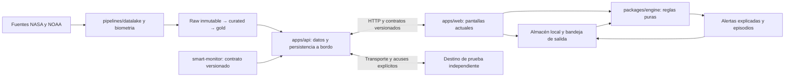

# Plan maestro de implementación de VIGÍA

> **Plan vigente para la siguiente implementación:** [PLAN-IMPLEMENTACION-COMPLETO.md](PLAN-IMPLEMENTACION-COMPLETO.md). Reúne T01–T44, dependencias, datos, responsables, criterios y puertas de validación. El contenido siguiente se conserva como antecedente de la integración anterior; sus estados y secuencia no sustituyen al plan vigente.

Fecha de revisión local: 2026-11-15; ejecución desde 2026-11-16T00:00:00Z. Estado: reconciliado con `origin/main`, con entregas de ingeniería ejecutadas; producto completo y piloto aún pendientes.

## Actualización científica ejecutada, 16-nov-2026 UTC

Se revisaron las fichas de los diez ganadores 2025 y las guías actuales; véase [comparación y fuentes](GANADORES-2025-Y-ESTRATEGIA-CIENTIFICA.md). Se añadieron `tools/investigacion`, `tools/validacion`, comparadores y ablaciones del motor TS, elegibilidad pura de evidencia, registro de afirmaciones y `/ciencia/evidencia`. Acerca de ahora muestra el reporte verificado, su vigencia, omitidos e incertidumbre, en lugar de KPI fijos. La captura temporal por observación sigue pendiente; el filtro ambiental compartido ya se usa.

El banco exploratorio evalúa 780 misiones sintéticas: motor completo 60/60 derivas intensas y 1/60 sutiles. No demuestra superioridad ni utilidad clínica. La cifra histórica 99,8 % queda acotada a su generador de desarrollo; no se ajustaron reglas sobre el banco nuevo. El [pitch actualizado](PITCH-CIENTIFICO.md) y el [protocolo profesional](PROTOCOLO-REVISION-CIENTIFICA.md) incorporan ese resultado. Se comprobó bibliografía: 35 DOI/títulos identificados y dos fragmentos por revisar; esto no constituye dictamen profesional.

Continúan sin completar episodios integrales, autenticación, aislamiento general del almacén, caracterización del reloj, receptor terrestre independiente y evaluación reservada. No se añadieron datos humanos ni revisores ficticios. La tabla de entregas siguiente conserva el hito de ingeniería anterior; el cierre de esta ampliación consta en VERIFICACION.

## 1. Base, alcance y límites de esta entrega

Repositorio principal revisado: `C:/Users/ASUS-08/Desktop/Proyecto-nasa-Create Health Monitoring Software for Astronauts on Space Missions`.

Base revisada: `cf5d53f184ea71ebf6e638d08e7ebee95f9c548c`. `git fetch origin` completado y `git merge origin/main` respondió `Already up to date`: HEAD coincide con el main remoto consultado. El nombre local `main` sigue en `817c78e`; no se usó como última revisión. Rama de trabajo: `docs/analisis-innovacion-vigia`, con los cambios de esta entrega sin commit.

La primera revisión no pudo sincronizar. Ese bloqueo quedó resuelto mediante los permisos del entorno. No se borraron documentos ni se importó completa una rama experimental; se conservó el borrador `ANALISIS-Y-PLAN-DE-INNOVACION.md`.

El trabajo está integrado en este repositorio: código, pruebas, documentación y herramientas. Datos y artefactos de verificación quedan en carpetas ignoradas. La base existente se respaldó y migró de v4 a v6; conserva las tablas de cuentas y recuperó `reloj_vinculo`. No se activó autenticación experimental ni se hizo push, PR o despliegue.

Se siguieron `AGENTS.md`, `SETUP.md`, `CONVENCIONES.md`, índice y MODULE de los módulos afectados. El plan antiguo por etapas y la revisión en 817c78e son antecedentes; no justifican recrear módulos existentes ni migrar a Vite.

### 1.1 Cambios de main y ejecución actual

| Entrega | Resultado actual | Límite o siguiente trabajo |
| --- | --- | --- |
| G0 | Main remoto confirmado en cf5d53f. Ya trae rutas por rol, Marte de 259 días, intradía, restauración gold, lock pnpm y CI de tipado/build. | Fetch/merge de nuevo antes de un PR futuro. |
| P0-01 | 005/006, rechazo de números duplicados, upgrades de ambas formas v4, respaldo y migración local a v6. | Cuentas conservadas; falta integrar y auditar autenticación y CSRF. |
| P0-02/04 | API y ruff instalados; Node portátil 22.18 verificado; build valida TypeScript; setup/arquitectura alineados. | Python local 3.14.1 frente a CI 3.12. Instalación desde cero no ensayada aquí. |
| P0-03 | GOES y DONKI reciente consultados; SEP 2011–2012 en cinco tramos; dos paneles publicados; KPI reproducido con hash idéntico a la fixture. | DONKI reciente vacío no cubre el futuro: declarado en `faltan`. RadLab/EDA siguen como referencias. |
| P1-02 parcial | Síntomas e informes con operación estable, unicidad por dueño, reenvío concurrente y conflicto 409. | Falta el sobre general y cerrar colisiones/acuse parcial de todos los componentes. |
| P1-04 parcial | Bandeja de informes por misión/tripulante/modo, instantánea de contenido/acción, reintento en segundo plano, conflicto conservado y caché de cola. | HealthStore principal sigue en localStorage por modo; faltan identidad, aislamiento general e IndexedDB. |
| P1-05 parcial / H10 | Referencia separada de escenario; históricos no activan cabina real; dosis por detector sin promedio/Gy→Sv ni porcentaje personal. | Faltan contrato completo de evidencia, vigencia/comparabilidad y revisión profesional. |
| P1-07 corrección previa | El contador no confirma recepción: se exige estado de la API. | La API aún simula entrega por tiempo; falta receptor independiente en Tierra. |
| Verificación | `tools/verificacion`: 340 pruebas aprobadas sin omitidas, lint/tipado/build y contexto en verde; Chrome recupera el informe tras reinicio y sin red sin duplicarlo; respaldo SQLite restaurado en copia temporal. | Evidencia y límites exactos en VERIFICACION; no sustituye reloj físico o piloto humano. |

La hipótesis de innovación sigue siendo detección personal + evidencia + seguimiento. Esta ejecución fortalece los cimientos, pero **no implementa aún un episodio clínico de principio a fin**, el benchmark reservado ni la revisión profesional. Las siguientes fases P1/P2 mantienen sus criterios de aceptación.

## 2. Resultado que se busca

Convertir el prototipo integrado en un sistema reproducible y preparado para un piloto supervisado: cada señal conserva su procedencia; la decisión declara sus límites; una alerta puede abrir un seguimiento; los registros sobreviven a fallos de red y reinicios; el acceso y la entrega de información se comprueban; los resultados se pueden repetir y cuestionar.

Hipótesis de innovación a evaluar: **la combinación de detección personal, calidad de evidencia y seguimiento de episodios mejora una decisión concreta con menor carga que un tablero de umbrales fijos**.

La meta de ingeniería se expresa mediante criterios de aceptación. El plan no promete eficacia clínica del 100 %, aprobación NASA, certificación ni preparación para vuelo. Esas conclusiones necesitarían procesos y evidencia adicionales.

## 3. Capacidades que se conservan

| Área | Estado comprobado en código/base local | Decisión |
| --- | --- | --- |
| Frontend | Next.js, React, TypeScript, Tailwind, cuerpo 3D con respaldo 2D, registro guiado, tendencias, entorno, alertas, informes y dispositivo. | Extender las pantallas existentes y conservar marca, controles táctiles y navegación. |
| Motor | Implementaciones reales de A, B con mediana/MAD y C con CUSUM; adaptación y cambio de instrumento. | Evolucionar el motor puro; no sustituirlo por otro mock ni reescribirlo. |
| Datos | GOES, DONKI, RadLab y EDA; raw/curated/gold, manifiestos y lectura idempotente. | Consolidar cobertura, aplicabilidad y restauración antes de ampliar fuentes. |
| API | FastAPI, SQLite, migraciones, consentimiento, alertas, reportes y puente smart-monitor. | Cerrar integridad temporal, autenticación y compatibilidad de migraciones. |
| Sin conexión | Service worker, caché de catálogos y cola de registros/alertas. | Completar informes, aislamiento, recuperación y actualización de versiones. |
| Modos | Separación real/demo implementada. | Añadir la distinción entre observación actual, referencia histórica y escenario. |
| Evidencia | Fixtures, simulador y pruebas de paridad Python/TypeScript. | Añadir evaluación independiente y comparadores más exigentes. |

Las afirmaciones de la primera revisión del frontend aislado sobre ausencia de motor, API o ingesta **no describen este monorepo**.

## 4. Hallazgos iniciales que determinaron el orden

La tabla conserva el diagnóstico sobre 817c78e. La sección 1.1 registra qué cambió en main y qué se corrigió ahora: H01–H04, H09–H11 y parte de H13 ya cambiaron. H05, H06, H08, H12 y el circuito completo de episodios siguen abiertos.

| ID | Hallazgo | Evidencia | Consecuencia |
| --- | --- | --- | --- |
| H01 | Dos migraciones distintas comparten número 004. | `main`: `004_reloj_vinculo.sql`; rama `feat/acceso-seguro-camara`: `004_autenticacion.sql`. El migrador compara solo el entero con `PRAGMA user_version`. Reproducción en memoria: una queda omitida. | Resolver antes de integrar la rama o arrancar sobre una base existente. |
| H02 | La base local tiene versión 4 y tablas de cuentas, pero carece de `reloj_vinculo`; tampoco tiene `token_csrf`, presente en la revisión de la rama consultada. | Inspección SQLite en modo de solo lectura. `quick_check` devuelve `ok`. | Una base íntegra físicamente puede ser incompatible con el código; hace falta reconciliación explícita y respaldo. |
| H03 | No existe `panel-mision-real.json` ni su entrada en gold. | Inventario de los 11 productos publicados localmente; la API busca ese panel en modo real. | Publicar el panel y mostrar disponibilidad/cobertura; un pull no descarga datos ignorados por Git. |
| H04 | El KPI servido desde gold no coincide con la fixture vigente. | Gold generado el 14-11; fixture del 15-11. Difieren estructura y hash; gold no tiene el bloque `parametros` de la fixture. | Unificar procedencia y regeneración; informe, API y presentación deben apuntar al mismo resultado. |
| H05 | El historial agrega los últimos valores de cada día y les atribuye una única hora. | `_lecturas_reales` en `apps/api/rutas_dashboard.py`; el cliente también usa la hora de envío para cada indicador del registro. | Preservar hora por observación y no construir evaluaciones aparentemente simultáneas con mediciones dispersas. |
| H06 | La identidad actual de main usa `X-Tripulante`. | `rutas_registro.py`, `sincronizacion.ts`. | Aplicar identidad autenticada y permisos en servidor; el selector de rol no autoriza acciones. |
| H07 | La rama de cámara contiene trabajo útil, pero su acceso facial documentado es un prototipo de presencia. | `feat/acceso-seguro-camara`, `documentacion/VIGIA-acceso-seguro-y-camara.md`: perfil fijo, sin identificación ni autenticación por el rostro; la ruta local no sincroniza. | Auditar y rescatar por partes; no presentar detección facial como autenticación ni perder sincronización existente. |
| H08 | Almacenamiento principal en localStorage por modo, sin partición general por misión y usuario; caché con claves compartidas. | `apps/web/lib/storage.ts`. | Migrar a almacenamiento transaccional aislado, con recuperación comprobada. |
| H09 | Los informes propios no tienen bandeja de salida persistente equivalente a la del registro. | `api-registro.ts`, pantalla de informes y backlog B7. | Poder redactar, cerrar la app y reenviar una sola vez al volver el enlace. |
| H10 | El porcentaje de límite de carrera mezcla una referencia personal con dosis ambientales; existe supuesto µGy=µSv y promedio entre detectores. | `pipelines/reanclaje/panel.py`. | Revisar magnitudes y aplicabilidad antes de ampliar recomendaciones de exposición. |
| H11 | Arquitectura y setup no están completamente alineados con la implementación. | Arquitectura aún menciona Vite/módulos futuros; setup pide Node 20+, README/CI usan 22.18+; npm y pnpm tienen locks. | Documentar stack real y una instalación canónica. |
| H12 | La evaluación sintética detecta peor la deriva sutil. | Fixture: 99,8 % a intensidad completa y 17,8 % a media intensidad; misma familia de generadores. | Evaluar límites y utilidad incremental antes de publicar superioridad. |
| H13 | Falta cierre de ingeniería en CI y entorno. | `ignoreBuildErrors: true`; sin paso de tipado/build web en CI; faltan websockets y ruff localmente. | Comprobar build, no omitir integración del reloj y resolver avisos SQLite. |

No todos los hallazgos son errores clínicos: varios son límites explícitos de un prototipo. El plan evita convertirlos en capacidades supuestamente ya validadas.

## 5. Reglas para la implementación

1. Ramas `<tipo>/<tema>`, commits en español e infinitivo, un problema por PR y revisión por otra persona; no cambios directos en main.
2. Sincronizar antes del PR mediante `git fetch origin` y `git merge origin/main`. Conservar los documentos sin seguimiento y resolver sus posibles colisiones antes de actualizar.
3. Hook `.githooks`, `MODULE.md` MANUAL actualizado y bloques AUTO/índice regenerados con contextgen; no editarlos a mano.
4. Mantener `apps`, `pipelines`, `packages` y `tools`; las aplicaciones consumen datos por contratos/API, no importan código de los pipelines. Mantener el motor sin IO.
5. Textos visibles desde i18n: español primero, inglés secundario conforme al repo; completar inglés para los materiales de competencia cuando corresponda.
6. No incorporar datos masivos ni registros personales a Git. Solo fixtures pequeñas, anonimizadas y con condiciones de reutilización comprobadas.
7. Datalake, i18n y contextgen siguen con biblioteca estándar. Una dependencia adicional requiere justificación y acuerdo según las convenciones.
8. Conservar `t_real` UTC canónico. No inventar horas a partir de tiempos relativos de un estudio. Mantener origen y precisión temporal originales.
9. No borrar datos ni reconstruir una base para ocultar una migración fallida. Respaldar, ensayar restauración y reconciliar esquemas de forma explícita.

## 6. Arquitectura de destino



La pérdida de Internet/Tierra y la pérdida de la API local se prueban por separado. A bordo puede seguir disponible la LAN y la API aunque no exista enlace a Tierra.

### 6.1 Contratos mínimos

| Contrato | Campos/propiedades necesarias | Destino |
| --- | --- | --- |
| Observación v2 | ID estable, misión, sujeto, indicador, original/unidad y normalización vinculada, hora de medición y recepción, precisión temporal, instrumento/sitio/método, perfil vigente, procedencia y versión. | Schemas → API/SQLite → web/motor. |
| Evidencia | `utilizable`, `requiere_confirmacion`, `insuficiente`, `no_comparable`, motivos, antigüedad/cobertura y observaciones que la sostienen. | Campos separados del nivel de alerta. |
| Procedencia | `naturaleza` observada/simulada; `uso` operativo/referencia/escenario; dataset/versión/producto, hash, ubicación, aplicabilidad y transformación. | No deducir uso operativo de la palabra Real. |
| Episodio | ID, alertas/observaciones enlazadas, responsable, estado, protocolo/versión, tareas/plazos, acciones, remedir, impedimentos, revisión y cierre justificado. | Persistencia local/API y vista de seguimiento. |
| Sobre de sincronización | ID de operación, propietario, tipo/versión, hash, intentos, estado, acuse y error categorizado. | Bandeja local y receptor idempotente. |
| Informe | Instantánea de evidencia y reglas al redactarlo, destino, permiso, retardo, estado y acuses; respuesta con su propio transporte. | No reinterpretar un informe antiguo con el perfil actual. |

Los esquemas actuales representan registros diarios y la API también maneja lecturas escalares. Documentar esos niveles y sus adaptadores: hoy `lectura.schema.json` usa `Medido/Simulado`, mientras la API usa `Real/Simulado`. No hacer un reemplazo global sin migración y pruebas de compatibilidad.

### 6.2 Comportamiento en las pantallas existentes

| Pantalla | Cambio útil para la persona |
| --- | --- |
| Cuerpo | Estado y suficiencia de evidencia separados; última medida utilizable; siguiente tarea del episodio. Una zona sin mediciones no comunica normalidad. |
| Registro | Mantener una medida por paso y guardar solo lo confirmado. Registrar hora/método; permitir repetir una lectura ligada al episodio. El objetivo de 90 s es tiempo de interacción y se mide; no implica hacer todas las mediciones físicas en ese tiempo. |
| Tendencias | Selección de episodio, puntos originales/repetidos, cambio de instrumento y banda personal vigente; calidad accesible mediante lenguaje sencillo. |
| Entorno | Fuente, fecha real, ubicación, cobertura, vigencia y uso histórico/operativo; distinguir dosis ambientales y observaciones remotas. |
| Alertas | Seguimiento abierto/pendiente, nueva medición, revisión y cierre; mostrar qué se compartió y el acuse real. |
| Informes | Borrador local, pendiente, aceptado a bordo, transmitido, confirmado por destino y respondido; solo mostrar estados que el transporte pruebe. |
| Dispositivo | Mantener diagnóstico por pasos; comprobar equipo vinculado, frescura y calidad. No convertir el pulso de 1 Hz en FC en reposo. |
| Acerca de | Capacidades, límites y resultados generados desde el mismo artefacto versionado; referencias verificables. |

Mantener tokens visuales, tipografías locales, iconografía y respaldo 2D. Solo añadir una vista de episodios si los recorridos demuestran que no cabe con claridad en Alertas/Informes. Actualizar rutas/cache del service worker cuando sea necesario. No introducir una migración a Vite ni un rediseño completo como requisito.

## 7. Secuencia de entregas y PR

P0: impide una integración o evidencia confiable. P1: núcleo del piloto. P2: ampliación condicionada a resultados. Cada PR incluye cambios, pruebas pertinentes, riesgos, reversión y documentación.

| Orden / rama propuesta | Alcance concreto | Dependencia | Criterio de aceptación |
| --- | --- | --- | --- |
| G0 · sincronización · HECHO | Fetch/merge de origin/main y revisión de cf5d53f, inventario renovado y backlog reconciliado en §1.1. | Completada. | Repetir antes de publicar PR. |
| P0-01 · `fix/migraciones-compatibles` | Detectar versiones duplicadas; diseñar migraciones siguientes para reconciliar bases con reloj, cuentas o ambos; ledger/checksums si se adopta por ADR. | G0. | Instalación limpia y upgrades desde ambas variantes v4 conservan datos y terminan con tablas esperadas; interrupción revierte; ejecutar de nuevo no cambia resultados. |
| P0-02 · `chore/entorno-y-ci` | Unificar Node con CI, documentar entorno Python, gestor/lock, instalar requirements faltantes; tipado/build web en CI; quitar ignoreBuildErrors al quedar verde. | G0. | Checkout limpio instalable; Python/TS/contexto/lint/tipado/build aprobados; integración de reloj no omitida por dependencia ausente. |
| P0-03 · `data/restaurar-paneles-y-kpi` | Manifiesto de bootstrap, verificación de fuentes, publicación real/demo, regeneración de KPI desde código/semilla vigentes. Actualizar endpoint DONKI y probar fallback. | P0-02. | API y fixture exponen la misma versión/hash de resultados; panel real disponible o ausencia explicada; raw intacto. |
| P0-04 · `docs/arquitectura-y-capacidades` | Actualizar arquitectura/setup y sustituir instrucciones obsoletas; mapa afirmación→prueba→límite. | G0, P0-02. | No instrucciones de Vite o módulos inexistentes; cada capacidad tiene estado implementado/probado/pendiente. |
| P1-01 · `feat/observaciones-versionadas` | Schemas, almacenamiento y adaptadores con hora por indicador, original/normalización, instrumento y perfil; conservar eventos intradía. | P0-01. | Un valor extremo seguido de uno normal conserva ambas observaciones y su evaluación; signos separados por horas no producen una toma conjunta ficticia. |
| P1-02 · `fix/reintentos-idempotentes` | IDs de operación para registros, síntomas, alertas e informes; transacción de lote o acuses por componente. | P1-01. | Caída tras guardar síntomas o perder un acuse no duplica síntomas/reportes ni pierde componentes; conflicto visible. |
| P1-03 · `feat/identidad-y-permisos` | Revisar/rescatar la rama de acceso; sesión verificada en servidor, autorizaciones por misión/rol/consentimiento, revocación y permisos de respuesta. | P0-01, ADR de identidad. | Suplantar X-Tripulante no autoriza; médico/astronauta/tierra solo ven y hacen lo permitido; la detección de un rostro no concede identidad. |
| P1-04 · `feat/almacen-local-y-bandeja` | IndexedDB detrás de HealthStore; partición usuario/misión/modo; migración conservadora de localStorage, cola de informes/acciones y aislamiento de caché. | P1-01/02/03. | Sin API: guardar, cerrar y reabrir; al reconectar sincronizar una vez. Cambiar usuario no filtra datos ni envía operaciones del anterior. |
| P1-05 · `feat/calidad-y-aplicabilidad` | Elegibilidad por contexto, vigencia, cobertura y comparabilidad; estado de evidencia separado del riesgo; configuración revisada. | P1-01. | Un histórico no dispara una recomendación sobre la cabina actual; ausencias no se vuelven OK; extremos no desaparecen por un filtro de calidad. |
| P1-06 · `feat/episodios-y-seguimiento` | Tres recorridos: lectura por confirmar, deriva de sueño/FC y evento ambiental aplicable; tareas, impedimentos, remedir, revisión/cierre auditados. | P1-04/05 y protocolo revisado. | Recorrido completo recuperable tras reinicio; no cerrar por caducidad de una alerta; conocer regla y protocolo usados. |
| P1-07 · `feat/transporte-con-acuses` | Simulador de enlace desacoplado con receptor de Tierra, retardo ida/vuelta, interrupciones, duplicados y acuse; distinguirlo de entrega operativa real. | P1-02/04/06. | El paso del tiempo no significa recepción; destino confirma por ID; respuesta y reintentos conservan causalidad. |
| P1-08 · `test/banco-de-validacion` | Runner que ejecuta el motor TS de producto, escenarios reservados, comparadores, ablaciones y reporte versionado. | Empieza tras P0-02; acompaña P1. | Resultados repetibles con intervalos y casos negativos; reglas congeladas antes de abrir el conjunto reservado. |
| P2-01 · `data/orion-y-calidad-ambiental` | Piloto de una ventana Orion; detector, magnitudes, cobertura, ubicación y reconstrucción verificables. | P0-03, P1-05. | Producto pequeño trazable; detectores separados; sin dosis efectiva personal inferida. |
| P2-02 · `data/biometria-inspiration4` | Importar tablas procesadas CBC/CMP candidatas desde nuevo pipeline; referencia histórica separada; vista dentro de tendencias. | P1-01/05, revisión de archivos/unidades. | Sujetos/tiempos unidos por metadatos; NA como ausencia; originales preservados; no nuevas alarmas clínicas por defecto. |
| P2-03 · `feat/vigilancia-cognitiva` | Factibilidad de protocolo, tarea instrumentada y condiciones/validez de sesión; caracterización del dispositivo. | P1-06/08 y revisión del protocolo. | Implementación web caracterizada; sesiones interrumpidas inválidas; no afirmar validación heredada de PVT publicado. |
| P2-04 · `docs/piloto-y-resultados` | Ensayo de usabilidad, revisión profesional y paquete reproducible con resultados favorables y limitaciones. | Criterios técnicos y de datos cumplidos. | Informe permite reconstruir versión, datos, métodos, errores y alcance de cada afirmación. |

La autenticación y la bandeja local se diseñan juntas. WebAuthn puede ser parte del acceso al servidor, pero no resuelve por sí solo cifrado/recuperación de datos ni desbloqueo sin API. La política offline debe especificar identidad previamente verificada, duración, cierre de sesión y comportamiento ante revocación. No construir reconocimiento facial clínico ni usar presencia facial como sustituto.

Para el conflicto 004 se añadió la reconciliación 005 y se ensayaron ambas variantes sin perder datos. La base local ya se respaldó y migró; las cuentas se conservan sin activarlas. Integrar la rama de autenticación aún requiere numeración propia y reconciliar sus columnas: no basta con renombrar su 004.

## 8. Datos y dependencias

El inventario, los datasets candidatos, las comprobaciones de entrada y lo que falta descargar están en [DATOS-Y-EVIDENCIA.md](DATOS-Y-EVIDENCIA.md).

Decisión de alcance: primero restaurar y hacer coherentes las cuatro fuentes ya presentes. Después integrar **una ventana Orion** y, si el seguimiento de laboratorio entra en el alcance, **dos tablas procesadas CBC/CMP**. FLR amplía la cronología solar después de corregir la base DONKI. PDS marciano/lunar, ómicas masivas y datos restringidos no bloquean el núcleo.

| Necesidad | Acción propuesta | Instalación ahora |
| --- | --- | --- |
| Dependencias de la API | Requirements ya declara websockets; instalado 15.0.1. | Hecha en el venv existente. |
| Lint | Ruff 0.17.5 en el mismo entorno y configuración del repo. | Hecha. |
| Node | Ejecutable portátil 22.18 con SHA-256 oficial; Node global sigue en 22.12. | Hecha; ruta en VERIFICACION. |
| E2E | Chrome DevTools Protocol con stdlib, sin dependencias nuevas de producto. | Implementado en tools/verificacion; Playwright queda como alternativa futura. |
| Persistencia | Preferir IndexedDB nativo detrás de la interfaz actual; evaluar wrapper solo si reduce complejidad comprobada. | No se presupone Dexie. |
| Autenticación | Auditar las dependencias ya declaradas en la rama antes de adoptarlas y fijar versiones compatibles. | No instalar la rama completa ni MediaPipe para resolver identidad. |
| Análisis estadístico | Mantener primera evaluación con stdlib y motor TS; un módulo analítico adicional declara sus propias dependencias. | No se requieren pandas, PyTorch, Spark o una base vectorial para el alcance inicial. |

## 9. Evidencia y evaluación

### 9.1 Banco previo a nuevos ajustes del detector

Congelar código, configuración, datos, generador y conjunto reservado antes de comparar. Los valores publicados actuales no son objetivos a recuperar modificando reglas.

Antes de abrir el conjunto reservado, acordar qué mejora práctica justifica el cambio: por ejemplo, menor retraso a igual presupuesto de falsas alertas, o menos mediciones sin perder eventos relevantes. El tamaño de esa mejora se fija a partir de la línea base y la revisión del caso de uso; no se inventa ahora un porcentaje favorable. Si no se demuestra, comunicar el resultado negativo y mantener la innovación como hipótesis.

Comparadores mínimos: umbrales por parámetro actuales; desviación personal sencilla; A sola; A+B; A+C; A+B+C; versión con contexto/calidad. Separar el resultado de reglas ambientales deterministas del resultado de detectar una deriva.

Escenarios: intensidad continua, inicio temprano/tardío, progresión y recuperación, ausencia de prevuelo, cambio de instrumento/perfil, ruido correlacionado/no gaussiano, datos faltantes en bloques, sensor fijo, valores extremos, desfase horario y mediciones intradía contradictorias. Incluir misiones sin anomalía y casos que requieren abstención. Encargar una parte de los escenarios a una persona que no ajuste el motor.

Métricas: detección por episodio y por intensidad; retraso desde un inicio definido; falsos episodios por persona-semana; duración de alertas; fracción de tiempo con datos suficientes; abstenciones justificadas; error por grupo/tipo de instrumento. Dar denominadores e intervalos, sin contar filas longitudinales como personas independientes. Informar también las misiones no detectadas; la mediana de retraso solo entre detectadas debe rotularse así.

Si aparecen datos humanos independientes, separar personas/misiones entre ajuste y evaluación. La paridad Python/TS y una segunda semilla verifican aspectos distintos de una validación externa. Los datos CBC/CMP no validan un detector diario de fatiga.

### 9.2 Pruebas de operación y recuperación

- Pérdida de Internet, pérdida de API local y caída del servidor del reloj como fallos distintos.
- Cierre/reapertura y reinicio con observación, episodio e informe pendientes; pérdida de acuse y envío parcial.
- Cambio de usuario/modo/misión con operaciones en curso; cierre de sesión y permisos retirados.
- Almacenamiento lleno, copia corrupta, migración incompleta, reloj desajustado y servicio worker actualizado.
- Backups SQLite y datos de referencia: restauración ensayada con comprobación de integridad y versiones, sin datos sensibles en logs.
- Dispositivo físico: vínculo, pérdida de señal, lectura antigua, dos relojes con mismo nombre y cambio de instrumento. El simulador del protocolo no sustituye este ensayo.

### 9.3 Usabilidad y revisión profesional

Primera ronda propuesta: 5–8 personas para descubrir errores de interacción, sin representar una validación clínica. Medir por separado tiempo de interacción y tiempo de adquirir mediciones; proporción que completa la tarea sin ayuda; errores al interpretar incertidumbre; carga por alertas y remedir. No declarar cumplido el objetivo de 90 segundos hasta cronometrarlo en condiciones definidas.

Revisar con un profesional de salud los tramos, agregación propia, aplicabilidad a misión, síntomas, glucosa y recomendaciones. Revisar el módulo de dosis con especialista adecuado. Mantener protocolo, fuentes, versión, revisor y fecha; sin revisión, las nuevas recomendaciones permanecen como borradores. Para estudios con datos personales externos al equipo, definir consentimiento y el proceso institucional aplicable antes de recolectar.

### 9.4 Evidencia que acompaña cada release

Matriz requisito→contrato→código→prueba→resultado→límite; manifiesto de datasets/hashes; versión del motor/protocolos; resultados del benchmark; registro de cambios; dependencias y licencias; riesgos abiertos; procedimiento de instalación y restauración; grabación de los tres recorridos; distinción entre pruebas automatizadas, ensayo físico y revisión profesional.

El panel, Acerca de, README e informes toman sus cifras del mismo artefacto de resultados. Toda cifra publicada identifica conjunto, versión y naturaleza sintética/humana.

## 10. Calendario de referencia y responsables

Supuesto: dos desarrolladores con dedicación sustancial, apoyo recurrente de una persona de datos/evaluación y revisión profesional disponible. Es una estimación de organización, no un plazo de validación clínica. Recalcular tras G0 y los primeros PR; algunos trabajos comparten infraestructura y no deben sumarse dos veces.

| Ventana orientativa | Entrega | Responsables funcionales |
| --- | --- | --- |
| Semanas 1–2 | Sincronización, migraciones, instalación/CI, datos/KPI coherentes, contratos acordados. | Backend + frontend + datos. |
| Semanas 2–5 | Observaciones íntegras, identidad, aislamiento y bandeja durables. | Backend + frontend; revisión de seguridad. |
| Semanas 5–8 | Calidad y tres episodios completos; transporte de prueba con acuses. | Backend + frontend + revisor de protocolos. |
| Semanas 3–10 | Banco reservado, escenarios adversos y comparación incremental. | Evaluación, con revisión independiente del ajuste. |
| Semanas 7–10 | Ventana Orion; laboratorio solo si aporta al caso de uso elegido. | Datos + frontend + especialista. |
| Semanas 9–12 | Factibilidad y caracterización de vigilancia cognitiva, si pasa su puerta de entrada. | Frontend + evaluación + revisor. |
| Semanas 12–16 | Piloto supervisado, restauración, evaluación y documentación de resultados. | Equipo y revisores. |

Primer hito revisable: **una medición trazable abre un episodio, se confirma, se registra una acción y una nueva lectura, sobrevive a reinicio sin API y se sincroniza sin duplicados**. Este hito tiene prioridad sobre ampliar datasets, cámara o modelos predictivos.

## 11. Puertas de salida

| Puerta | Evidencia requerida |
| --- | --- |
| G0 · base confirmada | Pull/HEAD remoto verificados y plan reconciliado con los cambios nuevos. |
| G1 · instalación reproducible | Migraciones de ambas variantes, dependencias, suites, tipado, build y contexto aprobados. |
| G2 · integridad de datos | Observaciones con horas propias; manifiestos/hashes; datos aplicables separados de referencias; KPI coherentes. |
| G3 · operación confiable | Tres recorridos persisten, se recuperan y sincronizan; permisos comprobados y acuses reales del destino de prueba. |
| G4 · utilidad investigada | Benchmark reservado con comparadores y límites; evaluación de interacción; recomendaciones revisadas. |
| G5 · piloto preparado | Alcance y participantes definidos, consentimiento/proceso institucional aplicable, capacitación, soporte y plan de incidentes/recuperación. |

G5 habilita el piloto acordado. No equivale a desplegar un dispositivo médico ni a autorizar una misión espacial.

## 12. Fuera de la primera entrega

Diagnóstico por rostro/voz, prescripciones generativas, predicción de daño personal desde GOES, gemelo digital fisiológico, descarga masiva de ómicas y múltiples relojes sin caracterización. FHIR y otras exportaciones se priorizan cuando exista un receptor y un intercambio concreto que probar. Masa corporal, correcciones metrológicas y nuevos límites se incorporan tras revisar fundamento y método; no para aumentar la cifra de funciones.

## 13. Continuación después de esta ejecución

G0 y las entregas de §1.1 ya se ejecutaron. Los comandos siguientes documentan el flujo para una rama futura; no hay que recrear la rama actual. Continuar por P1-01 (tiempos por observación) y P1-03 (identidad) antes del episodio completo. Revisar el diff y la evidencia existente.

```powershell
git status --short --branch
git pull origin main
git rev-parse HEAD
git config core.hooksPath .githooks
git switch -c fix/migraciones-compatibles
```

Antes del pull, preservar los dos documentos sin seguimiento; si existe una colisión con archivos entrantes, conservar sus contenidos fuera de la ruta de destino y revisar el diff. No ejecutar reset --hard, clean ni recrear la base.

Tras unificar el intérprete conforme a SETUP y verificar Node con la versión del CI:

```powershell
.\venv\Scripts\python.exe -m pip install -r apps/api/requirements.txt
.\venv\Scripts\python.exe -m pip install ruff
.\venv\Scripts\python.exe -m unittest discover -s apps/api
node --test packages/engine/*.test.ts apps/web/lib/*.test.ts
.\venv\Scripts\python.exe tools/contextgen/contextgen.py --check
.\venv\Scripts\python.exe tools/contextgen/contextgen.py --lint
.\venv\Scripts\python.exe -m ruff check .
```

Se reutilizó `venv` existente; no crear otro entorno por rutina. La comprobación completa está en `tools/verificacion/verificar.py --web`, con `--node` si hace falta el ejecutable portátil. En `apps/web`, usar `pnpm install --frozen-lockfile`, `pnpm exec tsc --noEmit` y `pnpm build`; pnpm es el gestor canónico. Separar las siguientes entregas en PR revisables.

Antes de abrir o actualizar cada PR:

```powershell
git fetch origin
git merge origin/main
.\venv\Scripts\python.exe tools/contextgen/contextgen.py
```

Revisar los archivos generados, ejecutar las pruebas afectadas y el chequeo de contexto. El PR explica problema, comportamiento final, evidencia y límites. La revisión de otra persona y CI verde siguen siendo requisitos del repositorio.

## 14. Fuentes y anexos

- [Verificación ejecutada y limitaciones](VERIFICACION.md).
- [Inventario, fuentes candidatas y plan de evidencia](DATOS-Y-EVIDENCIA.md).
- [NASA: inclusión de telemetría Artemis I en RadLab](https://science.data.nasa.gov/features-events/data-software-highlights-may-2026).
- [NASA CCMC: cambio de base de API DONKI](https://ccmc.gsfc.nasa.gov/news/major-updates/).
- [NASA: datos de Inspiration4 y niveles de acceso](https://www.nasa.gov/osdr-latest-news-i4-mission-datasets/).
- [OSDR OSD-575](https://osdr.nasa.gov/bio/repo/data/studies/OSD-575) y [OSD-569](https://osdr.nasa.gov/bio/repo/data/studies/OSD-569).
- [W3C WebAuthn](https://www.w3.org/TR/webauthn-3/): credenciales de clave pública; su presencia no valida un detector facial.
- [Playwright: instalación y pruebas E2E](https://playwright.dev/docs/intro).
