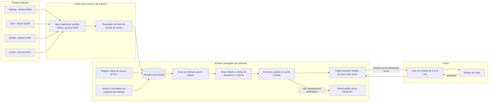
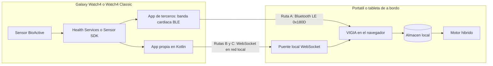

# VIGÍA: informe técnico para el reto Health Monitoring Software \(NASA Space Apps 2026\)

Nov 14, 2026 · @Naikissu

## Reto y condiciones de entrega

**Reto:** *Create Health Monitoring Software for Astronauts on Space Missions*, NASA Space Apps Challenge 2026\. Nivel Intermediate\. Temas: Human Exploration, Software, Space Exploration\. Agencia socia: Agencia Espacial Canadiense \(CSA\)\. El reto pide un software que reúna indicadores de salud y permita al astronauta evaluar su estado y actuar\. Sus cinco recursos oficiales son material de referencia de NASA HRP y de la CSA, no conjuntos de datos\.

**Entrega:** la demo es un video de 30 segundos como máximo o una presentación de hasta 7 diapositivas, enlazados con acceso público\. El formulario y los materiales van en inglés; un video en otro idioma lleva subtítulos en inglés\. El envío cierra el domingo 15 de noviembre a las 11:59 p\. m\., hora local\. Criterios: Impact, Creativity, Validity, Relevance y Presentation\.

## Trazabilidad con el enunciado oficial

Cada objetivo y cada consideración del enunciado tiene una respuesta concreta en VIGÍA\. La columna final indica qué entra en el prototipo del hackathon\.

*[Table view](https://miro.com/app/board/uXjVENjWII4=/?moveToWidget=3458764690457314469&cot=14)*

| Qué pide el reto | Tipo | Cómo responde VIGÍA | En el MVP |
| --- | --- | --- | --- |
| Herramienta visual para que el astronauta evalúe su propia salud y reciba orientación sobre tratamientos y mejoras | Objetivo | Estado por sistema con explicación y tarjeta de acción | Sí |
| Datos por cualquier entrada \(teclado, clics, imágenes de cámara\) que representen un indicador con su unidad | Objetivo | Registro diario con unidades visibles \(mmHg, latidos por minuto, mg/dL, °C, horas\); imagen de cámara como extensión | Sí, sin cámara |
| Usar recursos públicos para decidir qué indicadores sirven, cuáles se miden en el espacio, por qué hace falta el examen, cómo los afectan los peligros, cuándo avisar a la tripulación o al médico de vuelo y qué prevención existe | Objetivo | Ficha de cada indicador con esos seis campos, cada uno con su fuente \(sección 3\.2\) | Sí |
| Interfaz clara; se sugiere una figura humana en la que se hace clic para ver función y estado de cada parte | Objetivo | Figura humana interactiva como pantalla principal, coloreada por sistema | Sí |
| Información para distintos entornos: nave, estación, róver, base planetaria | Consideración | Perfil de misión que cambia retardo, gravedad y fuente de dosis | Tres perfiles |
| Recordar al astronauta que tome medidas o complete acciones de rutina | Consideración | Recordatorios del registro diario y de repetición de medidas | Sí |
| Ludificación, gráficas de indicadores en el tiempo, código de colores | Consideración | Gráficas de tendencia, verde, ámbar y rojo, rachas de registro | Gráficas y colores; rachas si hay tiempo |
| Instrucciones y explicaciones simples de medidas, indicadores y riesgos | Consideración | Guía de "cómo medir" y "por qué importa" en cada indicador | Sí |

**Indicadores de ejemplo que nombra el enunciado:** presión arterial, frecuencia cardíaca, glucosa en sangre, temperatura corporal, horas de sueño y estado de ánimo\. Los seis entran al registro diario\.

**Lo que VIGÍA añade por encima del enunciado:** un motor híbrido de tres capas, contexto ambiental con datos reales y operación con retardo de comunicación\. Eso sostiene Creativity y Validity; la tabla anterior sostiene Relevance\.

## 1\. Resumen ejecutivo y propuesta de valor

**El problema\.** En la Estación Espacial el astronauta enfermo tiene un médico de vuelo a menos de un segundo de distancia y una cápsula de regreso a horas\. En un tránsito a Marte la señal tarda hasta unos 22 minutos por trayecto y no hay evacuación posible\. La NASA llama a este cambio *Earth\-Independent Medical Operations* \(EIMO\): el cuidado y la decisión médica pasan progresivamente de tierra a la tripulación\. Hoy el software de salud en órbita está pensado para enviar datos a tierra, no para que el propio astronauta los interprete\.

**La solución\.** VIGÍA es una aplicación web que funciona sin conexión y convierte indicadores de salud en decisiones para quien los genera\. Su pantalla principal es una figura humana interactiva: cada zona muestra el estado de un sistema y, al tocarla, explica qué se mide, cómo medirlo y cuándo avisar\. El astronauta completa un registro diario de menos de 90 segundos\. Un **motor híbrido de tres capas** evalúa cada lectura: umbrales clínicos fijos de seguridad, desviación respecto a la **línea base personal** \(previa al vuelo durante la adaptación, en vuelo después\) y deriva lenta acumulada\. Cada resultado se cruza con el **entorno medido**: dosis de radiación, eventos de partículas solares y CO2, temperatura y humedad de cabina, tomados de datos abiertos de NASA y NOAA\. La salida es un estado verde, ámbar o rojo con su explicación, una acción recomendada y un reporte que viaja a tierra con el retardo del día de misión\.

**El diferencial\.** La mayoría de los prototipos de este reto son tableros que aplican rangos clínicos terrestres\. VIGÍA parte de tres hechos: el cuerpo en vuelo se desplaza respecto a esos rangos, los cinco peligros del vuelo espacial se potencian entre sí, y la tripulación decide sin la Tierra\. Por eso mide la desviación respecto a la persona sin renunciar a los límites clínicos de seguridad, y nunca muestra un síntoma sin el entorno que pudo causarlo\. En 500 misiones simuladas, el motor de referencia detectó la deriva inyectada a los 6 días de mediana, mientras un umbral fijo terrestre no llegó a dispararse \(sección 5\.5\)\.

## 2\. Diagnóstico del problema y estado del arte

*Criterios que atiende: Impact y Creativity\.*

### 2\.1 El problema, con evidencia

El Programa de Investigación Humana de la NASA \(HRP\) agrupa los riesgos del vuelo tripulado en cinco peligros, resumidos en la sigla RIDGE\. De ellos se derivan más de 30 riesgos de salud y desempeño documentados por el HRP\.

*[Table view](https://miro.com/app/board/uXjVENjWII4=/?moveToWidget=3458764690457314475&cot=14)*

| Peligro \(RIDGE\) | Efecto sobre la tripulación | Indicador que VIGÍA puede vigilar |
| --- | --- | --- |
| Radiación espacial | Riesgo de cáncer, daño a tejidos y al sistema nervioso; exposición aguda en eventos de partículas solares | Dosis acumulada, flujo de protones, síntomas agudos |
| Isolation: aislamiento y confinamiento | Alteraciones de ánimo, sueño y cohesión del equipo | Sueño, ánimo autorreportado, prueba de vigilancia |
| Distancia de la Tierra | Sin evacuación ni consulta en tiempo real; la tripulación decide sola | Retardo de señal del día; reportes diferidos |
| Gravedad alterada | Pérdida ósea y muscular, cambios cardiovasculares y visuales | Cumplimiento de ejercicio, masa corporal, presión arterial, síntomas visuales |
| Entorno cerrado y hostil | CO2, ruido, microbios, cambios inmunes | CO2, temperatura y humedad de cabina, síntomas |

Tres hechos fijan la magnitud:

- **Los peligros no actúan por separado\.** La NASA indica que se retroalimentan y agravan sus efectos\. Un monitor que mira cada señal aislada pierde justamente esa interacción\.
- **El retardo rompe el modelo actual\.** En la ISS el retardo por trayecto es menor a 0,25 s\. Hacia Marte llega a unos 22 minutos por trayecto, más de 40 de ida y vuelta\. La telemedicina sincrónica deja de ser viable\.
- **El modelo médico de la ISS es estabilizar y transportar\.** La documentación de EIMO parte de que en misiones tipo Marte no hay evacuación, ni retorno de muestras, ni asistencia terrestre inmediata\.

**Cifras de magnitud, confirmadas en fuentes NASA:**

- **Hueso:** pérdida media de 1 a 1,5 % de densidad ósea por mes en misiones de cuatro a seis meses\.
- **Visión \(SANS\):** cerca del 70 % de los astronautas de la ISS presenta alguna inflamación en el fondo del ojo; la NASA lo trata como prioridad de investigación para Marte\.
- **Radiación:** en la ISS la dosis efectiva se acumula a unos 0,2 a 0,5 mSv por día, entre 40 y 90 mSv en una misión típica de seis meses\. El límite de carrera es 600 mSv\.
- **Sueño y desempeño:** un estudio con 24 astronautas en misiones de seis meses asoció el déficit de sueño en vuelo con peor desempeño neuroconductual y más estrés\.

### 2\.2 Qué existe y por qué no alcanza

*[Table view](https://miro.com/app/board/uXjVENjWII4=/?moveToWidget=3458764690457314482&cot=14)*

| Solución actual | Qué hace | Cuello de botella |
| --- | --- | --- |
| Kit BP/ECG de la ISS | Mide ECG, frecuencia cardíaca y presión arterial | Voluminoso, pesado y de alto consumo según el propio equipo ExMC de la NASA |
| Bio\-Monitor / Astroskin \(CSA\) | Camiseta con sensores: ECG y pulso, presión arterial, respiración, temperatura de piel, SpO₂ y actividad; en la ISS desde 2019 | Diseñada para enviar datos a tierra, donde los científicos los analizan\. Batería de unas 48 horas |
| Conferencias médicas privadas con el médico de vuelo | Interpretación clínica desde tierra | Depende de comunicación casi instantánea; no escala a Marte |
| EIMO \(NASA HRP, elemento ExMC\) | Concepto de operaciones para autonomía médica | Es un marco y requisitos fundacionales, no un producto que la tripulación use hoy |
| Prototipos de otros equipos de este reto \(repositorios públicos 2026\) | Tableros de signos vitales con semáforo; algunos comparan reglas terrestres con reglas adaptadas al espacio | Usan umbrales poblacionales fijos; el entorno, cuando aparece, va en un panel aparte y no entra al razonamiento |

### 2\.3 El vacío exacto que cubrimos

Falta la capa que convierte datos en decisión **a bordo, sin tierra y con contexto**\. En concreto:

1. **Referencia personal\.** Un rango clínico terrestre no describe a un cuerpo adaptado al vuelo\. La señal útil es el cambio respecto a la propia línea base en misión\.
2. **Contexto ambiental dentro del razonamiento\.** Un dolor de cabeza con CO2 alto en cabina y uno con CO2 normal llevan a acciones distintas\.
3. **Operación degradada por diseño\.** Todo funciona sin enlace; el enlace solo sincroniza\.
4. **Explicación y acción\.** Cada alerta dice qué señal la disparó, cuánto se desvió y qué hacer, que es lo que pide el enunciado: evaluar y actuar\.

### 2\.4 Metrología biomédica en gravedad alterada

Un indicador medido en el espacio no es el mismo dato que en la Tierra: cambian la fisiología de referencia, la física del instrumento o ambas\. VIGÍA trata cada lectura como dependiente del perfil de misión \(gravedad y atmósfera de cabina\) y no solo de la persona\.

*[Table view](https://miro.com/app/board/uXjVENjWII4=/?moveToWidget=3458764690457314520&cot=14)*

| Indicador | Medición en Tierra \(1 g, 760 mmHg\) | Física e instrumento en el espacio | Impacto en el diseño de VIGÍA |
| --- | --- | --- | --- |
| Presión arterial | Manguito oscilométrico a la altura del corazón; la columna de sangre crea un gradiente hidrostático entre cabeza y pies | En 0 g desaparece el gradiente hidrostático y los fluidos se desplazan hacia la cabeza\. La presión braquial ambulatoria de 24 horas baja entre 8 y 10 mmHg tras 3 a 6 meses en la ISS, con una caída de 39 % en la resistencia vascular sistémica\. En la Luna y Marte el gradiente reaparece de forma parcial | La línea base en vuelo es obligatoria: un valor "normal" terrestre no lo es en órbita\. Se mide con manguito, brazo inmóvil\. Los tramos bajos de la capa A se interpretan por perfil \(sección 5\.1\) |
| CO2 de cabina | La concentración en ppm y la presión parcial son intercambiables porque la presión total es constante | El límite fisiológico es una presión parcial \(3 mmHg en promedio de una hora\)\. La misma lectura en ppm equivale a presiones parciales distintas según la presión total: 14,7 psia en la ISS, 10,2 psia en Gateway, 8,2 psia en la atmósfera de exploración | La conversión de ppm a mmHg usa la presión total del perfil\. Un umbral fijo en ppm es incorrecto fuera de la ISS \(sección 3\.3\) |
| SpO2 | Oxímetro de transmisión en el dedo; saturación de reposo estable a nivel del mar | La atmósfera de exploración \(8,2 psia, 34 % de O2\) es levemente hipóxica: presión inspirada de O2 de 128 mmHg, equivalente a unos 1 220 m de altitud\. En la ISS se usa oxímetro de dedo; la prenda Bio\-Monitor lo lleva en una banda de frente\. La evidencia terrestre indica que la frente se afecta menos por la vasoconstricción periférica que el dedo | La referencia de SpO2 depende del perfil\. En superficie se evalúa contra la línea base del propio perfil además del tramo extremo\. Se registra el sitio de medición y no se mezclan sitios |
| Masa corporal | Báscula gravimétrica: mide peso y supone g terrestre | En 0 g no hay peso\. SLAMMD aplica una fuerza conocida con dos resortes y mide la aceleración \(m = F/a\), con exactitud de 0,2 kg\. El dispositivo ruso BMMD usa la oscilación de un resorte\. Los dos difieren: en 25 tripulantes la pérdida media fue de 4,4 % según BMMD y de 2,8 % según SLAMMD\. En superficie se vuelve a pesar, con g local | Se guarda el método junto al valor\. No se comparan masas de instrumentos distintos sin anotarlo\. En superficie la lectura se corrige por la gravedad local |
| Temperatura corporal | Termómetro oral, timpánico o axilar; la convección natural y la evaporación disipan el calor | La gravedad reducida limita la convección y la eficiencia de la evaporación\. La temperatura central en reposo sube cerca de 1 °C tras 2,5 meses en la ISS y puede superar 40 °C en ejercicio\. Se midió con un sensor doble de flujo de calor en la frente, no con temperatura de piel | Un umbral de fiebre terrestre da falsos positivos en vuelo\. La temperatura de piel de un reloj no sustituye a la central\. Entrada manual con método declarado |
| Glucosa en sangre | Punción capilar y tira reactiva; la gota cae o se deposita por gravedad | La gota queda adherida por tensión superficial y se carga por capilaridad\. El riesgo es el material biológico flotante: los procedimientos de la ISS exigen contención\. Las tiras de glucosa oxidasa dependen del oxígeno de la muestra; las de glucosa deshidrogenasa no | Semanal, con procedimiento de contención en la ficha\. Se registra la enzima de la tira\. Preferencia por deshidrogenasa fuera de 14,7 psia, como precaución y no como requisito demostrado |
| Sueño | Actigrafía de muñeca con algoritmos validados en tierra | La NASA usa actigrafía de muñeca junto con un registro diario\. El sueño medio en vuelo es de 6 a 6,5 horas\. La tripulación duerme sujeta en saco, en cabinas con flujo de aire | La actigrafía nunca va sola: se combina con autorreporte\. Solo se usa la duración total, no la eficiencia ni la latencia |

**Tres afirmaciones habituales que la evidencia no sostiene tal como suelen formularse:**

- **Relojes y tiempo de tránsito del pulso\.** El Galaxy Watch no estima la presión por tiempo de tránsito, sino por análisis de la onda de pulso calibrado con un manguito cada 28 días\. No encontramos un estudio de NASA o CSA que mida su error en órbita\. El argumento para no usarlo es indirecto pero sólido: la calibración se hace en tierra y el vuelo cambia la resistencia vascular en 39 %, es decir, cambia la relación que la calibración supone constante\.
- **Glucosa deshidrogenasa "requerida"\.** La dependencia del oxígeno de la glucosa oxidasa está documentada, pero los ensayos en cámara hipobárica son contradictorios: algunos no hallan diferencia entre enzimas a 2 400 m simulados\. El propio HRP declara como brecha abierta que no se sabe cómo afecta la atmósfera de exploración al equipo médico\.
- **Sesgo de la actigrafía por oscilación del cuerpo en el saco\.** Es una hipótesis razonable y no encontramos una fuente que la mida\. Lo documentado es que la actigrafía estima bien la duración total y mal la eficiencia y la latencia\. VIGÍA no afirma ese sesgo; lo evita usando solo la duración y contrastándola con el autorreporte\.

Tampoco encontramos una fuente de NASA o CSA sobre el uso de termometría timpánica infrarroja en la ISS ni sobre la relación señal\-ruido de oxímetros de muñeca en microgravedad; el informe no hace afirmaciones sobre esos dos puntos\.

## 3\. Integración de datos de la NASA y agencias asociadas

*Criterios que atiende: Relevance y Validity\.*

VIGÍA usa mediciones abiertas reales para todo lo que describe el entorno y un escenario simulado, declarado como tal, para la fisiología diaria de la tripulación\. Los registros médicos de astronautas de agencia no son públicos; la única referencia humana real que se usa es la de Inspiration4, publicada en NASA OSDR\.

### 3\.1 Fuentes de datos

*[Table view](https://miro.com/app/board/uXjVENjWII4=/?moveToWidget=3458764690457314526&cot=14)*

| Dataset o misión | Fuente / agencia | Variables clave | Resolución espacial / temporal | Rol exacto en VIGÍA |
| --- | --- | --- | --- | --- |
| RadLab \(portal y Data API\) | NASA OSDR\. Detectores de ASI, de la Academia Búlgara de Ciencias y otros | Tasa de dosis absorbida \(µGy/h\), tasa de dosis equivalente \(µSv/h\) y flujo, por instrumento | Por módulo de la ISS y por nave\. Cadencia mediana: 5 min \(DosTel1, DosTel2, Lidal, REM\), 20 a 90 s \(Liulin\-5\), 60 s \(ALTEA\), 1 h \(CRaTER, LND\), 24 h \(RAD, REM y TEPC preliminares\) | Dosis ambiental\. Alimenta el contador de dosis acumulada de cada perfil de misión |
| Environmental Data Application \(EDA\) | NASA OSDR | Temperatura \(°C\), humedad relativa \(%\) y CO2 \(ppm\) de cabina; dosis acumulada y total | ISS y control en tierra; 21 misiones \(17 Rodent Research, APEX\-03\-1, APEX\-03\-2, APEX\-04, VEG\-01C\)\. La cadencia no está publicada: se calcula de las marcas de tiempo | Perfil real de cabina\. Permite distinguir un síntoma ambiental de uno fisiológico |
| DONKI | NASA CCMC, Goddard | Eventos de partículas energéticas solares \(SEP\): identificador, hora, instrumento, eventos ligados | Catálogo por evento, en JSON | Fija la hora real de inicio del modo tormenta |
| Flujo de protones GOES | NOAA SWPC | Flujo integral de protones en ≥10, ≥50 y ≥100 MeV | Órbita geoestacionaria; promedios de 5 minutos | Severidad del evento\. Umbral de evento de SWPC: 10 partículas/cm²·s·sr en ≥10 MeV |
| Inspiration4 \(OSD\-569, OSD\-575\) | NASA OSDR | Hemograma completo y panel metabólico en suero \(glucosa, sodio, potasio, albúmina\) | 4 tripulantes, 7 tomas a lo largo de 286 días; misión de 3 días | Valores humanos reales frente a la línea base de cada persona\. No se generaliza |
| Bio\-Monitor | CSA | ECG y pulso, presión arterial, respiración, temperatura de piel, SpO2, actividad | Continuo, hasta 48 h por carga | Esquema de señales del simulador y del modelo de datos |

RadLab cubre también el espacio profundo: CRaTER \(Lunar Reconnaissance Orbiter, órbita lunar\), LND \(Chang'e 4, superficie lunar\), MSL\-RAD \(Curiosity, superficie de Marte\), Liulin\-MO \(ExoMars TGO, crucero y órbita de Marte\) y BPD \(BioSentinel, órbita heliocéntrica\)\. Cada perfil de misión usa así un detector real de su entorno\.

### 3\.2 Recursos oficiales del reto y cobertura

*[Table view](https://miro.com/app/board/uXjVENjWII4=/?moveToWidget=3458764690457314535&cot=14)*

| Recurso | Agencia | Rol en VIGÍA |
| --- | --- | --- |
| 5 Hazards of Human Spaceflight | NASA HRP | Estructura de la figura humana y etiqueta de cada alerta |
| Risks of Human Spaceflight | NASA HRP | Base de las fichas de indicador; ver cobertura abajo |
| Ongoing HRP Research in Space | NASA HRP | Evidencia de qué se mide hoy en vuelo y con qué método |
| Monitoring radiation for astronaut health \(2026\) | CSA | Justifica el módulo de dosis y declara su límite: los neutrones aportan cerca del 30 % de la radiación en la ISS y los detectores usados no separan esa componente |
| Why do we conduct science experiments in space? | CSA | Impacto terrestre: los efectos en astronautas se parecen a un envejecimiento acelerado y al sedentarismo |

**Cobertura de los 17 riesgos que lista NASA HRP\.** La página agrupa 11 riesgos fisiológicos, 5 conductuales y de factores humanos, y 1 de radiación\.

*[Table view](https://miro.com/app/board/uXjVENjWII4=/?moveToWidget=3458764690457314538&cot=14)*

| Riesgo HRP | Indicador en VIGÍA | Cobertura |
| --- | --- | --- |
| Adaptaciones cardiovasculares | Frecuencia cardíaca en reposo, presión arterial | Completa |
| Sueño inadecuado y horarios irregulares | Horas de sueño; prueba de vigilancia | Completa |
| Cambios conductuales y trastornos psiquiátricos | Estado de ánimo diario | Completa |
| Cánceres inducidos por radiación | Dosis acumulada frente al límite de carrera | Completa \(dosis ambiental\) |
| Síndrome neuro\-ocular \(SANS\) | Síntoma visual autorreportado | Parcial: el diagnóstico requiere fundoscopio u OCT |
| Cambios óseos | Cumplimiento de ejercicio | Parcial: la densidad ósea no se mide en vuelo |
| Menor aptitud cardiorrespiratoria y musculoesquelética | Cumplimiento de ejercicio | Parcial |
| Respuesta inmune alterada | Síntomas: erupción, fiebre | Parcial |
| Función sensoriomotora y vestibular | Síntomas: náusea, mareo | Parcial; relevante en los días 1 a 3 |
| Alimentación y nutrición inadecuadas | Masa corporal semanal | Parcial |
| Hipoxia | SpO2 con umbral clínico | Parcial: no cubre el contexto de caminata espacial |
| Soporte inadecuado de operaciones | Operación autónoma con retardo | Abordado por diseño, no por indicador |
| Enfermedad por descompresión | Ninguno | Fuera de alcance |
| Lesión y desempeño en caminatas espaciales | Ninguno | Fuera de alcance |
| Interacciones huésped\-microorganismo | Ninguno | Fuera de alcance |
| Trabajo en equipo inadecuado | Ninguno | Fuera de alcance |
| Lesión por cargas dinámicas | Ninguno | Fuera de alcance |

**Qué aportan los 21 estudios de "Ongoing HRP Research"\.** La página lista 3 estudios en Artemis II, 10 en órbita baja y 8 concluidos\. Los que fijan decisiones de diseño:

*[Table view](https://miro.com/app/board/uXjVENjWII4=/?moveToWidget=3458764690457314545&cot=14)*

| Estudio | Qué mide o prueba | Decisión en VIGÍA |
| --- | --- | --- |
| ARCHeR \(Artemis II\) | Actigrafía de muñeca: movimiento, sueño y exposición a luz; bienestar | El sueño entra por actigrafía cuando hay sensor y por autorreporte cuando no |
| Standard Measures \(ISS y Artemis II\) | Conjunto mínimo y constante de medidas fisiológicas y psicológicas | El registro diario es corto y siempre el mismo |
| CIPHER | Varios sistemas corporales a la vez | Una sola vista por sistemas en la figura humana |
| Tempus Pro | Dispositivo comercial de telemedicina que integra datos de salud para diagnóstico remoto casi en tiempo real | Antecedente directo; VIGÍA cubre el caso en que no hay tiempo real |
| Immune Biomarkers, Altered Immunity | Sangre, saliva y orina para cambios inmunes | Síntomas inmunes en el registro; los biomarcadores quedan para tierra |
| B\-Complex, Thigh Cuff, Brain Fluid Pressure, Spinal Fluid Biomarkers | Contramedidas y mecanismos de los cambios de ojo y cerebro | La ficha de visión cita las contramedidas en estudio, sin recomendarlas |
| Zero T2 | Ejercicio sin cinta de correr | El cumplimiento de ejercicio es indicador, no adorno |
| Venous Haemostasis | Flujo sanguíneo y coagulación | Riesgo declarado como no vigilable sin ecografía |
| Food Acceptability, Food Physiology | Aceptación de la comida y dieta mejorada | Masa corporal semanal |
| Space Gardening | Si cultivar alivia el aislamiento | Las acciones sugeridas incluyen actividades con sentido, no solo descanso |

Los cinco estudios restantes \(Omics Archive, Spinal Health, Simulating Manual Piloting for Moon Landings, Spacecraft Occupant Protection y Veggie Monitoring\) no cambian el diseño del prototipo\.

**Fichas de indicador\.** Cada indicador del registro lleva seis campos, con fuente: qué es, cómo se mide en vuelo, por qué hace falta, qué peligro lo altera, cuándo avisar y qué prevención existe\. El campo "cómo se mide en vuelo" es una instrucción operativa que cambia con el perfil de misión \(sección 2\.4\)\.

*[Table view](https://miro.com/app/board/uXjVENjWII4=/?moveToWidget=3458764690457314547&cot=14)*

| Indicador | Cómo se mide en vuelo \(instrucción de la ficha\) | Capa del motor |
| --- | --- | --- |
| Presión arterial sistólica | Manguito oscilométrico en el brazo\. Sujetarse con las restricciones de pies, brazo inmóvil y relajado durante el inflado; en 0 g la altura del brazo no importa, el movimiento sí\. En superficie, sentado y con el manguito a la altura del corazón\. Dos lecturas; registrar la segunda | A; B contra la línea base del perfil |
| SpO2 | Sensor siempre en el mismo sitio \(dedo o frente\) y anotado\. Mano tibia, 30 segundos sin moverse\. En atmósfera de exploración, comparar con la línea base del perfil | A |
| Temperatura | Termómetro de temperatura central con método declarado, en reposo y al menos 30 minutos después del ejercicio\. No usar temperatura de piel | A, con referencia en vuelo |
| Frecuencia cardíaca en reposo | Sensor de muñeca o prenda; valor de reposo del día, nunca una lectura suelta | A, B y C |
| Sueño | Hora de acostarse y de levantarse en el registro; actigrafía como contraste\. Solo duración total | B y C |
| Estado de ánimo | Escala de 1 a 10 a la misma hora cada día | B y C |
| Glucosa \(semanal\) | Guantes; punción con lanceta; la gota queda adherida al dedo y se acerca a la tira para que cargue por capilaridad; gasa y bolsa de residuos biológicos a mano\. Anotar la enzima de la tira | B |
| Masa corporal \(semanal\) | En 0 g, dispositivo inercial \(SLAMMD o BMMD\), cuerpo rígido y sujeto al brazo guía; anotar cuál\. En superficie, báscula con corrección de gravedad local | C |
| Síntomas | Lista cerrada: cefalea, náusea, mareo, visión, erupción | Reglas con contexto |
| Dosis de radiación | Dosímetro de área del perfil | Contexto |

Esquema de una ficha, con la instrucción separada por perfil:

```json
{
  "id": "presion_arterial_sistolica",
  "unidad": "mmHg",
  "frecuencia": "diaria",
  "metodo": "manguito_oscilometrico",
  "como_se_mide_en_vuelo": {
    "estacion": "Pies en las restricciones. Brazo inmovil y relajado. Dos lecturas; registrar la segunda.",
    "transito": "Igual que en estacion.",
    "superficie": "Sentado, manguito a la altura del corazon. Dos lecturas; registrar la segunda."
  },
  "por_que": "Vigila la adaptacion cardiovascular y la respuesta al ejercicio.",
  "peligro": "gravedad_alterada",
  "referencia_en_vuelo": "La presion braquial de 24 h baja entre 8 y 10 mmHg en orbita.",
  "cuando_avisar": "Tramo extremo de la capa A, o desviacion persistente de la linea base del perfil.",
  "prevencion": "Ejercicio aerobico y de resistencia segun el plan de vuelo.",
  "fuentes": ["https://physoc.onlinelibrary.wiley.com/doi/10.1113/jphysiol.2014.284869"]
}
```

### 3\.3 Ingesta y puntos de acceso

El script `vigia\_ingesta\.py` prueba las cuatro fuentes, valida el código HTTP y la estructura, limpia los datos y guarda JSON estáticos con URL, hora de consulta y huella SHA\-256 en `manifest\.json`\. La aplicación lee esos archivos, así que la demo no depende de la red\.

*[Table view](https://miro.com/app/board/uXjVENjWII4=/?moveToWidget=3458764690457314551&cot=14)*

| Fuente | Punto de acceso | Estructura esperada | Limpieza |
| --- | --- | --- | --- |
| GOES | https://services\.swpc\.noaa\.gov/json/goes/primary/integral\-protons\-1\-day\.json | Arreglo de objetos con time\_tag, satellite, flux, energy | Se conservan ≥10, ≥50 y ≥100 MeV; se descartan flujos negativos o de relleno y duplicados |
| DONKI | https://ccmc\.gsfc\.nasa\.gov/DONKI/WS/get/SEP?startDate=AAAA\-MM\-DD&amp;endDate=AAAA\-MM\-DD | Arreglo de objetos con sepID, eventTime, instruments\[\]\.displayName, linkedEvents\[\]\.activityID, link | Horas a UTC ISO 8601; una respuesta vacía significa sin eventos |
| RadLab | https://visualization\.osdr\.nasa\.gov/radlab/api/ con pares clave\-valor | CSV \(formato por defecto\) con timestamp, instrument\_id, absorbed\_dose\_rate, dose\_equivalent\_rate | Ventanas de un día; se descartan filas sin dosis; se guardan unidades |
| EDA | https://visualization\.osdr\.nasa\.gov/eda \(sin API documentada\) | Tabla de telemetría exportada desde Data Tables | El script convierte los CSV guardados en eda\_manual/ |

Tres precisiones sobre los puntos de acceso:

- **DONKI cambió de dirección\.** Un aviso del 30 de septiembre de 2026 traslada el servicio a `https://ccmc\.gsfc\.nasa\.gov`; las rutas que siguen a `/DONKI/` no cambian\. El script prueba la dirección nueva, la anterior \(`https://kauai\.ccmc\.gsfc\.nasa\.gov`\) y el espejo `https://api\.nasa\.gov/DONKI/SEP`, en ese orden\. Parámetros: `startDate` y `endDate` en formato `AAAA\-MM\-DD`; si se omiten, el servicio toma los últimos 30 días\.
- **El archivo de GOES solo trae las últimas 24 horas\.** Sirve para demostrar la ingesta en vivo\. Una tormenta histórica requiere el archivo de NOAA NCEI o se representa como escenario \(sección 3\.4\)\.
- **RadLab admite dos sintaxis que no se mezclan**, pares clave\-valor o expresión booleana\. El límite de carrera de la NASA está en mSv, así que la dosis acumulada usa `dose\_equivalent\_rate` cuando el instrumento lo ofrece; con dosis absorbida la comparación es solo orientativa y así se rotula\.

**Estado de la verificación\.** La estructura de DONKI, RadLab y EDA sale de su documentación oficial; la de GOES, de su uso por terceros\. La prueba en vivo de los cuatro puntos de acceso se hace al ejecutar el script en la red del equipo: su tabla de salida y `manifest\.json` son la evidencia\. Si una fuente devuelve otra estructura, el script la reporta como `ESTRUCTURA\_INESPERADA` en lugar de guardar datos incorrectos\.

**Límites de referencia \(NASA\-STD\-3001\)\.** Dosis efectiva total de carrera menor a 600 mSv, igual para todas las edades y sexos; 250 mSv por evento de partículas solares\. CO2: promedio de una hora no mayor a 3 mmHg en el volumen habitable\. El límite de CO2 es una presión parcial, así que no depende de la presión de cabina; la lectura en ppm sí\.

**Perfiles de misión y conversión de CO2\.** EDA y muchos sensores entregan CO2 en ppm\. La conversión es:

```javascript
ppCO2 (mmHg) = ppm * presion_total_cabina (mmHg) / 1 000 000
```

*[Table view](https://miro.com/app/board/uXjVENjWII4=/?moveToWidget=3458764690457314575&cot=14)*

| Perfil | Presión total nominal | O2 | Gravedad | 3 mmHg de CO2 equivalen a | Origen del valor |
| --- | --- | --- | --- | --- | --- |
| Estación \(ISS\) | 14,7 psia \(760 mmHg\) | 21 % | 0 g | 3 950 ppm | Atmósfera nominal de la ISS |
| Tránsito | 14,7 psia \(760 mmHg\) | 21 % | 0 g | 3 950 ppm | Valor previsto para el hábitat de tránsito a Marte |
| Tránsito, acoplado o en preparación de salida | 10,2 psia \(527 mmHg\) | 26,5 % | 0 g | 5 690 ppm | Atmósfera de Gateway y de preparación escalonada |
| Superficie lunar | 8,2 psia \(424 mmHg\) | 34 % | 0,165 g | 7 070 ppm | Atmósfera de exploración para misiones con salidas frecuentes |
| Superficie marciana | 8,2 psia \(424 mmHg\) | 34 % | 0,38 g | 7 070 ppm | Atmósfera de exploración |

Consecuencia práctica: 3 950 ppm es el límite en la ISS, pero en un hábitat a 8,2 psia esa misma lectura corresponde a solo 1,7 mmHg\. Un umbral fijo en ppm daría falsas alarmas en superficie y, aplicado al revés, dejaría pasar 5,4 mmHg en la estación\.

La presión es un parámetro configurable del perfil, no una constante del código\. Ninguna misión de superficie tiene todavía una atmósfera fijada; los valores son los nominales que la NASA recomienda o prevé\. Si el sensor de CO2 ya entrega presión parcial, o compensa presión por su cuenta, la conversión se omite: el perfil lo indica con `co2\_unidad`\.

```json
{
  "estacion":            { "presion_cabina_mmHg": 760, "o2_pct": 21.0, "g_rel": 0.0,   "co2_unidad": "ppm", "co2_limite_mmHg": 3.0, "masa_metodo": "inercial",     "retardo_s": [0, 1] },
  "transito":            { "presion_cabina_mmHg": 760, "o2_pct": 21.0, "g_rel": 0.0,   "co2_unidad": "ppm", "co2_limite_mmHg": 3.0, "masa_metodo": "inercial",     "retardo_s": [180, 1320] },
  "transito_acoplado":   { "presion_cabina_mmHg": 527, "o2_pct": 26.5, "g_rel": 0.0,   "co2_unidad": "ppm", "co2_limite_mmHg": 3.0, "masa_metodo": "inercial",     "retardo_s": [1, 3] },
  "superficie_lunar":    { "presion_cabina_mmHg": 424, "o2_pct": 34.0, "g_rel": 0.165, "co2_unidad": "ppm", "co2_limite_mmHg": 3.0, "masa_metodo": "gravimetrica", "retardo_s": [1, 3] },
  "superficie_marciana": { "presion_cabina_mmHg": 424, "o2_pct": 34.0, "g_rel": 0.38,  "co2_unidad": "ppm", "co2_limite_mmHg": 3.0, "masa_metodo": "gravimetrica", "retardo_s": [180, 1320] }
}
```

Dos correcciones más que dependen del perfil:

- **Masa en superficie\.** Una báscula calibrada para la Tierra muestra `masa \* g\_rel`\. La masa real es `lectura / g\_rel`: una lectura de 12,4 kg en la Luna corresponde a 75 kg\. Si la báscula ya está calibrada para la gravedad local, no se corrige y el perfil lo indica\.
- **SpO2 en atmósfera de exploración\.** La presión inspirada de oxígeno baja de unos 149 mmHg a nivel del mar a 128 mmHg, una hipoxia leve equivalente a unos 1 220 m\. La saturación de reposo esperable es algo menor; no citamos una cifra porque no encontramos una medida publicada para esa atmósfera en tripulaciones\. La línea base de SpO2 se reinicia al cambiar de perfil\.

### 3\.4 Sincronización temporal: qué es real y qué es escenario

Las series reales provienen de misiones y años distintos, así que no pueden superponerse por fecha\. El simulador las coloca sobre una línea de tiempo sintética de misión con estas reglas:

1. **Reanclaje sin modificación\.** De cada fuente se elige una ventana real continua\. Su primera marca de tiempo se asigna a un día de misión y el resto se desplaza con el mismo corrimiento\. Los valores no se escalan, no se suavizan y no se inventan puntos intermedios\.
2. **Doble marca de tiempo\.** Cada punto conserva su hora real \(`t\_real`, UTC\) junto a la hora de misión \(`t\_mision`\)\. La interfaz muestra la fuente y la fecha real al tocar cualquier dato ambiental\.
3. **Rejilla común\.** Las series se agregan a 5 minutos \(la cadencia de GOES y DosTel\) y a resúmenes diarios: máximo de flujo de protones, máximo del promedio horario de CO2 y dosis del día\.
4. **Sin correlación cruzada implícita\.** Que un pico de CO2 de una misión de 2018 y una tormenta solar de 2024 coincidan en el día 22 es una decisión del escenario\. El informe y la interfaz no presentan esa coincidencia como un hecho observado\.
5. **Coherencia real cuando es posible\.** DONKI, GOES y RadLab pueden pedirse para las mismas fechas reales, por ejemplo la tormenta de mayo de 2024\. En ese caso la relación entre el evento, el flujo y la dosis sí es real, y se indica\.

*[Table view](https://miro.com/app/board/uXjVENjWII4=/?moveToWidget=3458764690457314584&cot=14)*

| Elemento | Naturaleza | Cómo se rotula |
| --- | --- | --- |
| Dosis, flujo de protones, eventos SEP, cabina | Medición real reanclada | "Real", con fuente y fecha original |
| Calendario de la misión y día en que cae cada ventana | Escenario | "Escenario" |
| Signos vitales, sueño, ánimo y síntomas de la tripulación | Simulación con supuestos declarados | "Simulado" |
| Anomalías inyectadas para la demo \(deriva, pico de CO2\) | Simulación | "Simulado" |
| Hemograma y panel metabólico de Inspiration4 | Medición humana real | "Real", vista descriptiva separada |

**Por qué los datos de la NASA son indispensables\.** Sin RadLab no hay contador de dosis; sin DONKI y GOES no existe el modo tormenta; sin EDA el motor no distingue un síntoma ambiental de uno fisiológico; sin las páginas de HRP las fichas de indicador no tienen sustento\.

## 4\. Arquitectura técnica y metodología

*Criterios que atiende: Validity y Presentation\.*

Todo el razonamiento corre en el dispositivo de a bordo; la red solo se usa para precargar datos ambientales y para sincronizar reportes con tierra\.

### 4\.1 Flujo de extremo a extremo



Lectura del diagrama: los datos ambientales entran una sola vez, ya limpios; todo lo demás ocurre en el dispositivo\. La única salida automática de datos personales es el escalamiento por alerta roja al oficial médico\.

### 4\.2 Capas del sistema

*[Table view](https://miro.com/app/board/uXjVENjWII4=/?moveToWidget=3458764690457314591&cot=14)*

| Capa | Qué hace | Decisión de diseño |
| --- | --- | --- |
| Ingesta | Prueba las cuatro fuentes, limpia y guarda JSON con huella | Se ejecuta antes de la demo; en misión equivaldría a la telemetría de la nave |
| Reanclaje | Coloca las ventanas reales sobre la línea de tiempo de misión | Conserva la hora real de cada punto \(sección 3\.4\) |
| Captura | Registro diario de menos de 90 segundos; sensor o simulador | Entrada manual primero: funciona aunque falle el sensor |
| Almacén | Guarda lecturas, entorno, alertas y reportes en el dispositivo | Nada sale sin una regla explícita |
| Motor híbrido | Capa A clínica, capa B de desviación personal, capa C de deriva, y reglas con contexto | Reglas legibles y auditables; mismos parámetros que el motor de referencia en Python |
| Permisos | Verde y ámbar privados; rojo escala al oficial médico | Consentimiento previo al vuelo y registro de cada escalamiento \(sección 5\.4\) |
| Decisión | Figura humana, explicación y acción | Tres niveles como máximo, para reducir la fatiga de alarmas |
| Sincronización | Cola de reportes con el retardo del día de misión | Guardar y reenviar; la aplicación nunca espera a tierra |
| Vista de tierra | El médico de vuelo lee reportes y responde | Segunda pantalla de la demo |

**Dos componentes de interfaz\.** La figura humana es un SVG con zonas por sistema \(cabeza y ojos, corazón y vasos, hueso y músculo, sangre e inmunidad, mente y sueño\); su color sale del motor\. Las fichas de indicador son un archivo JSON con los seis campos que pide el reto y la URL de la fuente, de modo que la interfaz nunca muestra una afirmación sin origen\.

### 4\.3 Stack recomendado

*[Table view](https://miro.com/app/board/uXjVENjWII4=/?moveToWidget=3458764690457314602&cot=14)*

| Componente | MVP de hackathon | Proyección a producción |
| --- | --- | --- |
| Interfaz | React con Vite, como aplicación web progresiva \(service worker\) | La misma base empaquetada para la tableta de a bordo |
| Almacenamiento | IndexedDB mediante Dexie | Base local cifrada con registro de auditoría |
| Motor de análisis | TypeScript puro, sin servidor, con pruebas unitarias | Módulo validado clínicamente, versionado y con trazabilidad de reglas |
| Gráficas | Recharts o uPlot | Igual |
| Ingesta | Script de Python \(requests, pandas\) que genera JSON | Servicio conectado a la telemetría ambiental de la nave |
| Sensor | Simulador con el esquema de Bio\-Monitor; opcional, banda de pulso por Web Bluetooth | Integración con prendas tipo Bio\-Monitor; intercambio en formato HL7 FHIR |
| Despliegue | Vercel o GitHub Pages; repositorio público | Cómputo de a bordo, sin nube |

**Por qué este stack\.** No necesita servidor, se despliega en minutos y la propiedad central del producto \(funcionar sin conexión\) se demuestra apagando el wifi frente a los jueces\.

**Decisión de stack según el equipo\.** Si dos o más personas ya trabajan con React, se usa el stack de la tabla\. Si no, la opción por defecto es HTML, CSS y JavaScript sin framework, con Chart\.js incluido localmente y almacenamiento en IndexedDB o localStorage: el motor de análisis es el mismo, se despliega igual en GitHub Pages y un service worker de pocas líneas conserva el modo sin conexión\. Al menos otro equipo del reto entrega así\. Streamlit queda descartado porque exige servidor y rompe la demostración sin red\.

## 5\. Validación científica, viabilidad y gestión de riesgos

*Criterio que atiende: Validity\.*

VIGÍA no diagnostica: detecta desviaciones, las pone en contexto y propone el siguiente paso\. El motor combina tres capas porque ninguna sirve sola: un umbral estadístico único es peligroso para variables de seguridad, y un umbral clínico fijo es ciego a la deriva lenta\.

### 5\.1 Motor híbrido de tres capas

*[Table view](https://miro.com/app/board/uXjVENjWII4=/?moveToWidget=3458764690457314609&cot=14)*

| Capa | Variables | Regla | Resultado |
| --- | --- | --- | --- |
| A\. Seguridad clínica \(umbral fijo\) | SpO2, temperatura, presión arterial sistólica, frecuencia cardíaca | Tramos de NEWS2 \(Royal College of Physicians, 2017\) | Rojo si un parámetro cae en su tramo extremo o la suma es 5 o más; ámbar si la suma es 3 o 4 |
| B\. Desviación personal \(robusta\) | Frecuencia cardíaca en reposo, presión sistólica, glucosa, sueño, ánimo | Puntuación z modificada frente a la línea base vigente, dos días seguidos | Ámbar |
| C\. Deriva lenta \(CUSUM\) | Frecuencia cardíaca en reposo \(al alza\), sueño y ánimo \(a la baja\) | Suma acumulada unilateral con k = 0,75 y h = 5 | Ámbar |
| Contexto | Síntomas y entorno | CO2 por encima de 3 mmHg con cefalea; flujo de protones de 10 o más en ≥10 MeV | Alerta de entorno; modo tormenta |

**Capa A: tramos clínicos usados\.**

*[Table view](https://miro.com/app/board/uXjVENjWII4=/?moveToWidget=3458764690457314615&cot=14)*

| Parámetro | Tramo extremo \(3 puntos\) | 2 puntos | 1 punto | Normal |
| --- | --- | --- | --- | --- |
| SpO2 \(%\) | 91 o menos | 92 a 93 | 94 a 95 | 96 o más |
| Temperatura \(°C\) | 35,0 o menos | 39,1 o más | 35,1 a 36,0; 38,1 a 39,0 | 36,1 a 38,0 |
| Presión sistólica \(mmHg\) | 90 o menos; 220 o más | 91 a 100 | 101 a 110 | 111 a 219 |
| Frecuencia cardíaca \(lpm\) | 40 o menos; 131 o más | 111 a 130 | 41 a 50; 91 a 110 | 51 a 90 |

Esta capa está activa desde el primer día y no depende de ninguna línea base\. NEWS2 es un estándar terrestre para adultos hospitalizados y la temperatura se refiere a temperatura corporal, no de piel; se adopta como piso de seguridad hasta que un médico de vuelo fije los valores operativos\.

**Corrección metrológica de la capa A\.** Tres de sus cuatro parámetros se desplazan en vuelo por razones físicas, no patológicas \(sección 2\.4\): la presión sistólica baja entre 8 y 10 mmHg, la temperatura central en reposo sube cerca de 1 °C y la SpO2 de reposo baja en atmósfera de exploración\. Eso acerca valores normales de vuelo a los tramos de 1 punto \(sistólica de 101 a 110, temperatura de 38,1 a 39,0, SpO2 de 94 a 95\)\. La regla de diseño es: los tramos extremos, de 3 puntos, se aplican sin cambio en todos los perfiles porque son el piso de seguridad; los tramos de 1 y 2 puntos solo suman cuando la lectura además se aparta de la línea base del perfil\. El motor de referencia en Python aún aplica NEWS2 sin esta corrección, porque su escenario simulado no incluye esos desplazamientos; es el primer cambio pendiente del motor\.

**Capa B: puntuación z modificada\.** Para una lectura *x*, con la mediana y la desviación absoluta mediana \(MAD\) de la línea base vigente:

```javascript
M = 0,6745 * (x - mediana) / MAD
```

El umbral no es uniforme\. Para variables fisiológicas \(frecuencia cardíaca, presión, glucosa\) es |M| de 3,5 o más, el valor de Iglewicz y Hoaglin\. Para variables conductuales autorreportadas \(sueño, ánimo\) es 3,0\. En ambos casos se exige persistencia de dos días, y cada variable tiene un piso de dispersión para que una línea base muy estable no convierta ruido en alerta\. SpO2 y temperatura no pasan por esta capa: su rango fisiológico es estrecho y solo responden a la capa A\.

**Capa C: CUSUM\.** Acumula desviaciones pequeñas y sostenidas en un solo sentido\. Solo se activa cuando la línea base ya es por completo de vuelo \(día 21 en adelante\), porque durante la transición el desplazamiento propio de la adaptación la dispararía\. Los parámetros k = 0,75 y h = 5 salen de un barrido sobre misiones de control \(sección 5\.5\)\.

### 5\.2 Línea base: de tierra a vuelo

Los primeros días de vuelo no sirven como referencia\. El volumen plasmático cae cerca de 17 % en las primeras 24 horas y el mareo espacial suele ceder en 2 o 3 días; una línea base calculada con esos datos quedaría contaminada\. La lógica es:

*[Table view](https://miro.com/app/board/uXjVENjWII4=/?moveToWidget=3458764690457314626&cot=14)*

| Días de vuelo | Referencia | Capas activas |
| --- | --- | --- |
| Antes del vuelo \(14 días\) | Se registra la línea base de tierra | No aplica |
| 1 a 14 \(modo adaptación\) | Línea base de tierra, solo informativa | A y contexto\. B y C calculan y muestran, pero no alertan |
| 8 a 14 | Se empieza a sembrar la ventana en vuelo, sin usarla | Igual que arriba |
| 15 a 20 \(transición\) | Mezcla progresiva de tierra y vuelo | A, B y contexto |
| 21 en adelante | Línea base en vuelo | A, B, C y contexto |

El centro y la dispersión vigentes el día *d* son una mezcla con peso *w*:

```javascript
w(d) = 0                         si d <= 14 o la ventana en vuelo tiene menos de 5 lecturas
w(d) = min(1, (d - 14) / 7)      si d >= 15
centro(d)     = (1 - w) * mediana_tierra + w * mediana_vuelo
dispersion(d) = (1 - w) * MAD_tierra     + w * MAD_vuelo
```

La ventana en vuelo toma hasta 14 días, empieza en el día 8 y termina 3 días antes de la fecha evaluada\. Ese rezago evita que una deriva en curso se absorba en su propia referencia\. Los días con alerta se excluyen de la ventana\.

Durante el modo adaptación la interfaz lo dice de forma explícita: "cambio esperado por adaptación; se vigilan solo los límites de seguridad"\. La duración de 14 días es una decisión conservadora de diseño, no un valor clínico validado\.

### 5\.3 Flujo diario y prueba de vigilancia

El registro diario y la prueba de vigilancia son dos actividades distintas, con tiempos distintos\.

*[Table view](https://miro.com/app/board/uXjVENjWII4=/?moveToWidget=3458764690457314637&cot=14)*

| Actividad | Duración | Cuándo | Contenido |
| --- | --- | --- | --- |
| Registro diario | Menos de 90 segundos | Cada día | Frecuencia cardíaca, presión, SpO2, temperatura, sueño, ánimo y síntomas\. Con sensor, los cuatro primeros llegan solos |
| Registro semanal | Unos 2 minutos | Una vez por semana | Glucosa y masa corporal |
| Prueba de vigilancia PVT\-B | 3 minutos | Cada 3 días, o el mismo día si hay ámbar por sueño o CO2 sobre el límite | Tiempos de reacción; lapso a partir de 355 ms; salida en falso por debajo de 130 ms |

La PVT\-B es la versión de 3 minutos que la NASA usa en la ISS desde 2009 con el nombre Reaction Self\-Test\. En VIGÍA es un módulo posterior al núcleo del prototipo \(sección 7\.1\); el motor de referencia ya calcula cuándo debe ofrecerse\.

### 5\.4 Privacidad y escalamiento

La privacidad es la regla y la seguridad de la tripulación es la excepción acotada\.

*[Table view](https://miro.com/app/board/uXjVENjWII4=/?moveToWidget=3458764690457314644&cot=14)*

| Estado | Quién lo ve | Qué ocurre |
| --- | --- | --- |
| Verde | Solo el astronauta | Nada sale del dispositivo |
| Ámbar | Solo el astronauta | VIGÍA sugiere una acción y ofrece compartir\. Tras 3 días seguidos en ámbar, recomienda compartir, sin hacerlo por él |
| Rojo \(capa A\) | Astronauta y oficial médico de la tripulación | Escalamiento automático e inmediato |
| Alerta de entorno o modo tormenta | Toda la tripulación | Se comparte el dato ambiental, nunca los síntomas de cada uno |

Reglas del escalamiento automático:

- **Dato mínimo\.** Se envía el indicador, su valor, la hora y el tramo clínico\. No se envía el historial ni los demás indicadores\.
- **Transparencia\.** El astronauta ve en pantalla que el aviso salió y qué contenía\. No puede cancelarlo, pero sí añadir contexto\.
- **Consentimiento previo\.** La regla se acepta antes del vuelo y forma parte del acuerdo de la tripulación; no se improvisa en misión\.
- **Respaldo\.** Si el afectado es el propio oficial médico, el aviso va al comandante o al suplente designado\.
- **Registro\.** Cada escalamiento queda anotado con fecha y contenido, y entra a la cola hacia el médico de vuelo\.

### 5\.5 Protocolo de simulación y resultados

El script `vigia\_simulacion\.py` genera misiones de 30 días con 14 días previos al vuelo y 4 tripulantes, inyecta tres anomalías conocidas y las pasa por el motor de referencia\. La misma cantidad de misiones de control, sin anomalías, mide las falsas alarmas\.

*[Table view](https://miro.com/app/board/uXjVENjWII4=/?moveToWidget=3458764690457314658&cot=14)*

| Caso | Qué se inyecta | Cuándo | Qué debe ocurrir |
| --- | --- | --- | --- |
| A1\. Deriva cardiovascular por falta de sueño | Sueño −0,20 h por día, frecuencia cardíaca \+1 lpm por día, ánimo −0,15 por día, en un tripulante | Días 18 a 27 | Alerta ámbar por capa B o C dentro de la ventana |
| A2\. Cefalea por pico de CO2 | Máximo horario de CO2 de 4,6 mmHg; dos tripulantes reportan cefalea | Día 12 \(modo adaptación\) | Alerta de entorno para ambos, no dos alertas médicas |
| A3\. Tormenta solar | Flujo de 200 partículas en ≥10 MeV, dos días | Día 22 | Modo tormenta el mismo día |

Supuestos del escenario, todos declarados en el archivo de resultados: desplazamiento sostenido en vuelo de \+3 lpm, −0,7 h de sueño y −4 mmHg; adaptación aguda que decae con constante de 4 días\.

**Resultados del motor de referencia** \(500 misiones con anomalías y 500 de control, semilla 2026\):

*[Table view](https://miro.com/app/board/uXjVENjWII4=/?moveToWidget=3458764690457314664&cot=14)*

| KPI | Resultado | Lectura |
| --- | --- | --- |
| Anomalías inyectadas detectadas | 100 % \(A1, A2 y A3 al 100 %\) | A2 y A3 son reglas deterministas; el valor informativo está en A1 |
| A1 con la deriva a mitad de intensidad | 79 % | La sensibilidad cae con derivas débiles; no se presenta el 100 % como general |
| Alerta por azar en la misma ventana, misiones de control | 1,6 % | La detección de A1 no se explica por falsas alarmas |
| Días desde el inicio de la deriva hasta la alerta | 6 \(mediana\) | Con la deriva a mitad de intensidad, 8 |
| Umbral fijo terrestre \(frecuencia cardíaca de 91 lpm o más\) | No se disparó en ninguna misión | El adelanto en días no se puede calcular; el dato es que el umbral fijo no ve la deriva |
| Falsas alarmas por tripulante y semana, días 15 a 30 | 0,024 | Con otra semilla, 0,026 |
| Falsas alarmas por tripulante y semana, días 1 a 14 | 0,006 | El modo adaptación no genera alertas estadísticas |

**Límites de estos resultados\.** Son del motor de referencia en Python sobre datos generados por el mismo equipo, y los parámetros de CUSUM se ajustaron con ese generador, así que son optimistas\. No miden desempeño clínico\. El script exporta `caso\_referencia\.json` con las lecturas y las alertas esperadas día por día: el motor de la aplicación web debe reproducirlas antes de citar estas cifras como propias\.

### 5\.6 Supuestos, limitaciones y mitigación

*[Table view](https://miro.com/app/board/uXjVENjWII4=/?moveToWidget=3458764690457314673&cot=14)*

| Riesgo o limitación | Efecto | Mitigación |
| --- | --- | --- |
| Datos fisiológicos públicos de astronautas muy escasos \(Inspiration4: 4 personas, 3 días\) | No se puede medir sensibilidad real | Simulador con anomalías conocidas y supuestos declarados; resultados rotulados como simulación |
| Umbrales clínicos tomados de un estándar terrestre | Pueden no ajustarse a la fisiología en vuelo | Capa A como piso de seguridad; revisión por médico de vuelo antes de cualquier uso real |
| Parámetros estadísticos ajustados en simulación | Desempeño optimista | Segunda semilla y prueba a mitad de intensidad |
| GOES mide en órbita geoestacionaria | Su flujo no equivale al de la ISS ni al de un tránsito a Marte | Indica severidad y tiempo, nunca dosis del tripulante; se rotula en pantalla |
| RadLab entrega dosis del instrumento | No es la dosis personal | Se rotula; el contador es de dosis ambiental |
| Series reales de años distintos | Coincidencias que no ocurrieron | Reanclaje declarado y doble marca de tiempo \(sección 3\.4\) |
| Fatiga de alarmas | La tripulación ignora el sistema | Tres niveles, persistencia de dos días y falsas alarmas como KPI |
| Autorreporte sesgado | Un astronauta puede minimizar síntomas | Se combina con medidas objetivas |
| Escalamiento automático | Pérdida de confianza si se percibe como vigilancia | Dato mínimo, transparencia y consentimiento previo \(sección 5\.4\) |
| Uso como dispositivo médico | Riesgo regulatorio y ético | Aviso permanente: prototipo de apoyo a la decisión |
| Caída o cambio de una API | Demo rota | JSON precargados con fecha y huella |

## 6\. Impacto, usuarios objetivo y casos de uso

*Criterio que atiende: Impact\.*

### 6\.1 Usuarios

*[Table view](https://miro.com/app/board/uXjVENjWII4=/?moveToWidget=3458764690457314678&cot=14)*

| Perfil | Qué necesita | Qué le da VIGÍA |
| --- | --- | --- |
| Astronauta \(usuario principal\) | Saber en un minuto si está bien y qué hacer si no | Estado diario, explicación y acción; control sobre qué comparte |
| Oficial médico de la tripulación | Ver a toda la tripulación y priorizar, incluso si él es el enfermo | Vista de tripulación con los reportes que cada miembro autorizó |
| Médico de vuelo en tierra | Reportes completos que no exijan preguntas de ida y vuelta | Paquete con lectura, línea base, entorno y acción tomada |
| Misiones análogas y entornos remotos \(uso secundario\) | La misma autonomía en bases antárticas, hábitats análogos o zonas rurales | El mismo motor con otro perfil de entorno\. La CSA ya señala aplicaciones terrestres de Bio\-Monitor en comunidades con acceso limitado a salud |

**Validación de usuarios: qué está respaldado y qué hacer hoy\.** Los dos perfiles centrales salen del propio enunciado, que nombra a la tripulación y al médico de vuelo como quienes deben atender los resultados\. Lo que ninguna búsqueda sustituye es una opinión real\. Protocolo de 15 minutos: mostrar la aplicación a un profesional de salud o a alguien que trabaje aislado y preguntar tres cosas\. ¿Qué harías con esta alerta? ¿Qué dato te falta para decidir? ¿Qué te haría dejar de usarla? Se cita la respuesta con nombre y cargo, con permiso\. Si no se consigue a nadie, se dice que los perfiles provienen del enunciado y no se afirma validación\.

### 6\.2 Casos de uso

**Caso 1: registro diario con 20 minutos de retardo \(día 143 de tránsito\)\.**

1. La astronauta abre VIGÍA sin enlace y completa el registro en menos de 90 segundos\.
2. El motor detecta que su frecuencia cardíaca en reposo lleva seis días subiendo respecto a su línea base \(aviso por deriva, no por valor atípico\)\.
3. La pantalla muestra estado ámbar, la gráfica de la tendencia y el entorno: sueño reducido, sin evento solar, CO2 normal\.
4. Acción sugerida: priorizar sueño, repetir medición en 24 horas y enviar reporte\.
5. El reporte entra a la cola; el contador muestra cuándo llegará a tierra y cuándo puede volver la respuesta\.

**Caso 2: evento de partículas solares\.**

1. El flujo de protones de ≥10 MeV cruza el umbral de evento\. VIGÍA activa el modo tormenta con datos reales de un evento histórico de DONKI\.
2. Toda la tripulación recibe la recomendación de refugio y una lista de síntomas agudos que vigilar\.
3. Las lecturas tomadas durante el evento quedan marcadas, para que una náusea posterior se interprete con ese antecedente\.
4. Al terminar, el contador de dosis acumulada se actualiza y se muestra frente al límite de referencia\.

**Caso 3: síntoma con causa ambiental\.**

1. Dos tripulantes reportan cefalea el mismo día en su registro\.
2. El motor cruza los reportes con el CO2 de cabina, que está por encima de su perfil habitual\.
3. En lugar de dos alertas médicas individuales, VIGÍA emite una alerta de entorno: revisar ventilación y repetir la prueba\.
4. El oficial médico ve un solo problema con dos afectados, no dos pacientes\.

### 6\.3 Métricas de éxito

*[Table view](https://miro.com/app/board/uXjVENjWII4=/?moveToWidget=3458764690457314686&cot=14)*

| KPI | Cómo se mide | Valor | Estado |
| --- | --- | --- | --- |
| Anomalías inyectadas que el motor detecta | vigia\_simulacion\.py, 500 misiones | 100 %; 79 % en la deriva a mitad de intensidad | Medido en el motor de referencia |
| Detección frente a un umbral fijo terrestre | Días hasta la alerta; comparador de 91 lpm | Alerta a los 6 días de mediana; el umbral fijo no se disparó | Medido en el motor de referencia |
| Falsas alarmas por tripulante y semana | 500 misiones de control | 0,024 \(días 15 a 30\); 0,006 \(días 1 a 14\) | Medido en el motor de referencia |
| Funciones disponibles sin conexión | Prueba con la red apagada | Meta: 100 % de captura, análisis y decisión | Se mide con la aplicación |
| Tiempo del registro diario | Cronómetro con 5 personas | Meta: menos de 90 segundos | Se mide con la aplicación |
| Usabilidad | Escala SUS con 5 personas ajenas al equipo | Meta: más de 68 | Se mide con la aplicación |

Los tres primeros valores pasan a ser de la aplicación cuando su motor reproduce `caso\_referencia\.json` \(sección 5\.5\)\. Los tres últimos no tienen valor hasta medirlos; en la entrega se reporta la cifra obtenida o se omite\.

**Impacto por dimensión\.** Social: autonomía en salud para quien está lejos de un médico, en el espacio y en la Tierra\. Científico: un registro que une salud y exposición ambiental por persona, el dato que la investigación sobre interacción de peligros necesita\. Operativo: menos consultas de ida y vuelta por cada evento\. No se afirma impacto económico cuantificado porque no hay datos para sostenerlo\.

## 7\. Hoja de ruta: MVP del hackathon y escalabilidad

*Criterios que atiende: Validity e Impact\.*

El prototipo demuestra el ciclo completo \(capturar, contextualizar, decidir, reportar\) con un tripulante simulado y datos ambientales reales\.

### 7\.1 Qué se demuestra hoy

*[Table view](https://miro.com/app/board/uXjVENjWII4=/?moveToWidget=3458764690457314692&cot=14)*

| Función | Prioridad | Aparece en resumen y pitch |
| --- | --- | --- |
| Registro diario de menos de 90 segundos, con almacenamiento local | Imprescindible | Sí |
| Motor híbrido: capa A clínica, capa B de desviación y capa C de deriva | Imprescindible | Sí |
| Línea base de tierra a vuelo, con modo adaptación | Imprescindible | Sí |
| Figura humana interactiva con estado, explicación y acción | Imprescindible | Sí |
| Fichas de indicador con fuente | Imprescindible | Sí |
| Panel de entorno con datos reales de RadLab, EDA, DONKI y GOES | Imprescindible | Sí |
| Reglas con contexto: CO2 con cefalea y modo tormenta | Imprescindible | Sí |
| Privacidad por defecto y escalamiento de alertas rojas | Imprescindible | Sí |
| Modo sin conexión | Imprescindible | Sí |
| Cola de reportes con retardo y vista de tierra | Imprescindible | Sí |
| Tres perfiles de misión \(estación, tránsito, superficie\) | Alta | No |
| Recordatorios de medición | Alta | No |
| Prueba de vigilancia PVT\-B | Si hay tiempo | No |
| Rachas de registro | Si hay tiempo | No |
| Lectura de sensor por Bluetooth; entrada por cámara | Si hay tiempo | No |

Regla de coherencia: el resumen ejecutivo, el resumen del formulario y los guiones solo nombran funciones imprescindibles\. Si una función imprescindible no llega a la entrega, se retira de esos textos antes de enviar\.

**Fuera del prototipo, y se dice así en la presentación:** validación clínica, datos de tripulantes reales, dosis personal y cualquier forma de diagnóstico\.

### 7\.2 Evolución

*[Table view](https://miro.com/app/board/uXjVENjWII4=/?moveToWidget=3458764690457314703&cot=14)*

| Plazo | Objetivo | Entregables |
| --- | --- | --- |
| 3 meses | Validar el motor con datos humanos reales y públicos | Prueba con datos abiertos de vestibles terrestres; revisión de reglas por un médico; estudio de usabilidad con 10 a 15 personas |
| 6 meses | Probar en un entorno aislado | Piloto en una misión análoga o estación remota; integración con una prenda sensora comercial; reportes en formato HL7 FHIR |
| 12 meses | Acercarse a un sistema de apoyo a la decisión | Biblioteca de reglas versionada y auditada; módulo de dosimetría de espacio profundo; propuesta de colaboración con grupos de medicina aeroespacial; versión terrestre para salud rural |

**Socios: rutas abiertas reales, sin afirmar contactos que no existen\.** La hoja de ruta debe hablar de postulaciones, no de alianzas\. Tres vías públicas del propio HRP: el análogo HERA en Johnson \(hábitat de 650 pies cuadrados, misiones simuladas de hasta 45 días, con convocatoria de voluntarios\), las convocatorias de investigación HERO y el instituto TRISH\. La CSA, agencia socia del reto, es el destinatario natural por Bio\-Monitor y CANS\. Redacción sugerida para el pitch: "a seis meses, postular el protocolo a una convocatoria abierta de análogo"\. Si algún miembro tiene acceso a una universidad u hospital, ese es el piloto creíble y va primero\.

## 8\. Kit de entrega rápida

*Criterio que atiende: Presentation\.*

### 8\.1 Descripción corta \(Project Summary\), en español

En la Estación Espacial Internacional, un astronauta con un problema de salud tiene a su médico de vuelo a menos de un segundo de distancia\. Camino a Marte, la señal tarda hasta unos 22 minutos por trayecto y no existe evacuación\. La NASA llama a ese cambio Operaciones Médicas Independientes de la Tierra: la tripulación debe detectar, interpretar y actuar por sí misma\.

VIGÍA es una aplicación web que funciona sin conexión y ayuda a cada astronauta a evaluar su salud y decidir qué hacer\. Con un registro diario de menos de 90 segundos reúne signos vitales, sueño, estado de ánimo y síntomas\. Un motor de tres capas los evalúa: límites clínicos de seguridad, desviación respecto a la línea base personal \(la de tierra durante la adaptación al vuelo, la de vuelo después\) y sumas acumuladas para derivas lentas\.

Cada lectura se cruza con el entorno medido\. Usamos datos abiertos reales: dosis de radiación de detectores de la ISS \(RadLab, NASA OSDR\); CO2, temperatura y humedad de cabina \(Environmental Data Application, NASA OSDR\); eventos de partículas solares \(DONKI, NASA CCMC\) y flujo de protones de GOES \(NOAA SWPC\)\. Así VIGÍA distingue un síntoma fisiológico de uno causado por la cabina o por una tormenta solar, siguiendo los cinco peligros del vuelo espacial que define el Programa de Investigación Humana de la NASA\.

Una figura humana interactiva muestra el estado de cada sistema, y cada indicador trae instrucciones simples de cómo medirlo y por qué importa\. El resultado es un estado verde, ámbar o rojo con su explicación, una acción recomendada y un reporte que viaja a tierra respetando el retardo de comunicación\. Los datos de salud son privados por defecto; solo una alerta roja de seguridad avisa de forma automática al oficial médico de la tripulación\.

Los datos fisiológicos del prototipo son simulados; los ambientales son mediciones reales\. VIGÍA es una herramienta de apoyo a la decisión, no un dispositivo médico\. La misma arquitectura sirve a misiones análogas y a comunidades remotas en la Tierra\.

### 8\.2 Project Summary, versión en inglés

La guía oficial exige inglés en todo el formulario del proyecto, así que esta es la versión que se pega\.

On the International Space Station, an astronaut with a health problem is less than a second away from a flight surgeon\. On the way to Mars, a signal takes up to about 22 minutes each way and evacuation is not possible\. NASA calls this shift Earth\-Independent Medical Operations: the crew must detect, interpret and act on their own\.

VIGÍA \(Spanish for "lookout"\) is an offline\-first web app that helps each astronaut evaluate their health and decide what to do next\. A daily check\-in of under 90 seconds gathers vital signs, sleep, mood and symptoms\. A three\-layer engine evaluates them: clinical safety limits, deviation from the astronaut's own baseline \(the pre\-flight one during adaptation to flight, the in\-flight one afterwards\) and cumulative sums for slow drifts\.

Every reading is joined with the measured environment\. We use real open data: radiation dose from ISS detectors \(RadLab, NASA OSDR\); cabin CO2, temperature and humidity \(Environmental Data Application, NASA OSDR\); solar energetic particle events \(DONKI, NASA CCMC\); and GOES proton flux \(NOAA SWPC\)\. This lets VIGÍA tell a physiological symptom from one caused by the cabin or by a solar storm, following the five hazards of human spaceflight defined by NASA's Human Research Program\.

A clickable body figure shows the status of each system, and every indicator comes with plain instructions on how to measure it and why it matters\. The output is a green, amber or red status with its explanation, a recommended action and a report that travels to the ground under the mission's communication delay\. Health data is private by default; only a red safety alert automatically notifies the crew medical officer\.

Crew physiological data in the prototype is simulated; environmental data is real\. VIGÍA is a decision\-support prototype, not a medical device\. The same architecture serves analog missions and remote communities on Earth\.

**Límite de extensión\.** La guía de entrega no publica límite de palabras ni de caracteres para el resumen; el formulario mismo lo dirá al pegar\. Este texto ronda las 290 palabras y cada párrafo se sostiene solo, así que se recorta desde el final sin reescribir\.

### 8\.3 Guion de pitch \(240 segundos\)

*[Table view](https://miro.com/app/board/uXjVENjWII4=/?moveToWidget=3458764690457314710&cot=14)*

| Tiempo | Bloque | Qué se dice | Qué se ve |
| --- | --- | --- | --- |
| 0:00 a 0:25 | Gancho | "Te duele la cabeza y estás mareada\. Le escribes a tu médico\. La respuesta llegará en 44 minutos, si llega\. Estás a medio camino de Marte\." | Pantalla negra con un contador de retardo |
| 0:25 a 1:00 | Problema | La NASA define cinco peligros que se potencian entre sí\. En la ISS el modelo es estabilizar y regresar\. En Marte no hay regreso: la tripulación decide sola\. Los monitores actuales envían datos a tierra; no ayudan a decidir a bordo\. | Los cinco peligros; ISS frente a Marte en una línea |
| 1:00 a 2:30 | Demo y datos NASA | Registro diario en vivo, con el wifi apagado, en menos de 90 segundos\. La figura humana pasa a ámbar: "tu pulso en reposo lleva seis días subiendo respecto a tu propia línea base; ningún límite clínico lo habría marcado"\. Se abre el entorno: dosis real de un detector de la ISS \(RadLab\) y CO2 de cabina \(EDA\)\. Un evento solar real de DONKI activa el modo tormenta para toda la tripulación\. Una lectura roja de SpO2 avisa sola al oficial médico\. El reporte aparece en la vista de tierra tras el retardo\. | La aplicación en vivo; cada dato con su rótulo de real o simulado |
| 2:30 a 3:20 | Impacto | En 500 misiones simuladas, el motor detectó la deriva a los 6 días; el umbral fijo terrestre no se disparó nunca; 0,02 falsas alarmas por tripulante y semana\. Lo usan el astronauta, el oficial médico y el médico de vuelo\. En la Tierra: bases remotas y salud rural\. | Tres números grandes con la leyenda "simulación" |
| 3:20 a 4:00 | Cierre | Lo que es y lo que no: fisiología simulada, entorno real, apoyo a la decisión y no diagnóstico\. Próximo paso a 3 meses\. Frase final: "Cuando la Tierra tarda 22 minutos en contestar, el primer médico eres tú\. VIGÍA se asegura de que no estés a ciegas\." | Hoja de ruta en una línea; nombre y enlace |

**Origen de las cifras del bloque de impacto:** `resultados/kpi\.json`, generado por `vigia\_simulacion\.py`\. Son del motor de referencia\. Se citan como propias de la aplicación solo si su motor reproduce `caso\_referencia\.json`; si el motor cambia, se vuelve a ejecutar el script y se actualizan\.

### 8\.4 Demo oficial: 30 segundos o 7 diapositivas

El guion de 240 segundos sirve para la presentación ante el jurado local, si la sede la pide\. La demo que se enlaza en el formulario es mucho más corta: un video de 30 segundos como máximo o hasta 7 diapositivas, en inglés o con subtítulos en inglés\.

**Opción A: video de 30 segundos**

*[Table view](https://miro.com/app/board/uXjVENjWII4=/?moveToWidget=3458764690457314716&cot=14)*

| Tiempo | Voz o subtítulo \(inglés\) | Imagen |
| --- | --- | --- |
| 0 a 5 s | "Halfway to Mars, a message to your doctor takes 22 minutes each way\." | Contador de retardo sobre fondo negro |
| 5 a 11 s | "VIGÍA lets astronauts evaluate their own health\. Offline\." | Registro diario con el wifi apagado |
| 11 a 21 s | "It checks clinical safety limits, compares you with your own baseline, and adds real NASA data: ISS radiation dose, cabin CO2, solar particle events\." | Estado ámbar; panel de entorno con las fuentes visibles |
| 21 a 26 s | "It tells you why, and what to do next\." | Explicación y acción; reporte en cola |
| 26 a 30 s | "VIGÍA\. When Earth can't answer, you're not flying blind\." | Nombre y enlace |

**Opción B: 7 diapositivas**

1. Título: nombre, equipo, reto y una frase de valor\.
2. Problema: cinco peligros, 22 minutos de retardo, sin evacuación\.
3. Solución: capturar, contextualizar, decidir, reportar\.
4. Cómo funciona: línea base personal y reglas con contexto, con una captura real\.
5. Datos NASA y socios: RadLab, EDA, DONKI, GOES, Inspiration4; qué aporta cada uno\.
6. Resultados medidos en la simulación y usuarios\.
7. Límites declarados, hoja de ruta y enlaces al repositorio y a la aplicación\.

### 8\.5 Campos del formulario y declaración de uso de IA

*[Table view](https://miro.com/app/board/uXjVENjWII4=/?moveToWidget=3458764690457314721&cot=14)*

| Campo | Qué pide la guía | Qué pegar |
| --- | --- | --- |
| Project Name | Nombre del proyecto | VIGÍA |
| High\-Level Project Summary | Qué se desarrolló, cómo responde al reto y por qué importa | Texto de 8\.2 |
| Link to Project Demo | Video de 30 s o hasta 7 diapositivas, con enlace público | Enlace de 8\.4 |
| Link to Final Project | Proyecto completo en un sitio externo | Repositorio y aplicación desplegada |
| Detailed Project Description | Qué hace, cómo funciona, beneficios, qué se espera lograr, herramientas y lenguajes | Secciones 3 a 6, traducidas y condensadas |
| Use of Artificial Intelligence | Si se usó IA, cuáles herramientas y cómo | Declaración de abajo |

**Declaración de uso de IA\.** La guía permite usar IA y exige indicar dónde y cómo: las imágenes y videos generados llevan marca de agua visible, el código y los datos generados se reconocen en texto, y nada generado puede usar logotipos o identidad de la NASA\. El equipo usó un asistente de IA para investigar fuentes, redactar documentación y escribir los scripts de ingesta y simulación\. Texto para el formulario, a ajustar si cambia el uso:

> We used an AI assistant \(Claude, by Anthropic\) to research public NASA, CSA and NOAA sources, to draft and structure our project documentation and pitch, and \[if applicable: to help write and review code\]\. All sources were checked by the team and are cited\. The solution concept, design decisions and final code were reviewed by team members\. No AI\-generated images or videos are used\. \[Adjust if this changes\.\]

### 8\.6 Orden de trabajo sugerido para hoy

- [ ] Leer la página oficial del reto y contrastarla con la tabla de trazabilidad
- [ ] Ejecutar `vigia\_ingesta\.py` en la red del equipo y guardar `manifest\.json` como evidencia
- [ ] Descargar una tabla de telemetría de EDA a `eda\_manual/` y volver a ejecutar la ingesta
- [ ] Portar el motor híbrido a la aplicación y reproducir `caso\_referencia\.json`
- [ ] Construir registro diario, figura humana y fichas de indicador
- [ ] Implementar permisos y escalamiento de alertas rojas
- [ ] Activar el modo sin conexión y la cola con retardo
- [ ] Medir tiempo de registro y usabilidad con 5 personas
- [ ] Retirar del resumen y del pitch cualquier función imprescindible que no haya llegado
- [ ] Grabar el video de 30 segundos o armar las 7 diapositivas, y enviar el formulario en inglés

## Anexo A\. Integración de Samsung Galaxy Watch4 y Watch4 Classic

Los dos modelos sirven igual para VIGÍA: comparten sensores y sistema, y solo cambian tamaño, materiales y el bisel giratorio del Classic\. El reloj aporta frecuencia cardíaca en tiempo real, intervalos entre latidos, SpO2 a demanda y movimiento\. No aporta temperatura ni presión arterial utilizables por una aplicación propia, así que esos dos indicadores siguen entrando a mano\.

### A\.1 Qué entrega el reloj y qué no

*[Table view](https://miro.com/app/board/uXjVENjWII4=/?moveToWidget=3458764690457314729&cot=14)*

| Señal | Disponible en Watch4 y Classic | Cómo se obtiene | Cadencia |
| --- | --- | --- | --- |
| Frecuencia cardíaca | Sí | Health Services de Wear OS o Samsung Health Sensor SDK | 1 lectura por segundo |
| Intervalo entre latidos \(IBI\), para variabilidad | Sí | Samsung Health Sensor SDK | Con cada lectura de frecuencia |
| PPG crudo \(verde, infrarrojo, rojo\) | Sí | Samsung Health Sensor SDK | 25 Hz continuo; 100 Hz a demanda |
| Acelerómetro | Sí | Samsung Health Sensor SDK | 25 Hz |
| SpO2 | Sí | Samsung Health Sensor SDK, medición a demanda | Una medición por solicitud |
| ECG crudo | Sí | Samsung Health Sensor SDK, a demanda | 500 Hz |
| Composición corporal \(BIA\) | Sí | Samsung Health Sensor SDK, a demanda | Una medición por solicitud |
| Temperatura de piel | No | Solo desde Galaxy Watch5 | No aplica |
| Presión arterial | No para aplicaciones propias | El reloj la estima en la aplicación Samsung Health Monitor; el Sensor SDK no la expone | No aplica |
| Sueño por etapas | Indirecto | Samsung Health en el teléfono, vía Health Connect | Resumen diario, no tiempo real |

Tres condiciones de uso:

- **Sistema\.** Ambos modelos salieron con Wear OS 3 y admiten actualizaciones posteriores\. Health Services viene incluido desde Wear OS 3, así que la ruta B funciona sin importar la versión instalada\.
- **Sensor SDK\.** Funciona en Galaxy Watch4 y posteriores, no en emulador\. Para probar basta activar el modo desarrollador de Health Platform en el reloj; para distribuir la aplicación hay que solicitar el programa de socios de Samsung\.
- **Alcance declarado por Samsung\.** Los datos del Sensor SDK son de bienestar y forma física, no para diagnóstico ni tratamiento\. Encaja con el alcance de VIGÍA y debe decirse en la presentación\.

### A\.2 Qué cambia en el motor

*[Table view](https://miro.com/app/board/uXjVENjWII4=/?moveToWidget=3458764690457314775&cot=14)*

| Indicador de VIGÍA | Con el reloj | Capa |
| --- | --- | --- |
| Frecuencia cardíaca en reposo | Automática\. Se calcula como la mediana de la ventana de 5 minutos más baja del día con el reloj en la muñeca y sin movimiento | A, B y C |
| SpO2 | Semiautomática: el registro pide una medición de unos segundos en reposo | A |
| Variabilidad cardíaca | Nueva, derivada del IBI\. Entra como indicador informativo hasta tener línea base | B, más adelante |
| Sueño | Sigue siendo autorreporte en el prototipo; el acelerómetro permite estimarlo después | B y C |
| Temperatura y presión arterial | Manuales | A |

Con el reloj, el registro diario baja de siete campos a cinco, lo que ayuda a cumplir la meta de 90 segundos\. La capa A sigue necesitando temperatura y presión: el reloj no hace completo el motor por sí solo\.

**Por qué presión arterial y temperatura siguen siendo entradas manuales\.** No es solo que el SDK no las exponga; aunque lo hiciera, no serían válidas en vuelo\.

- **Presión arterial\.** El reloj no mide presión: la estima por análisis de la onda de pulso óptica, a partir de un modelo calibrado contra un manguito de brazo que Samsung exige repetir cada 28 días\. Esa calibración fija una relación entre la forma de la onda y la presión que depende del estado vascular del momento\. En órbita ese estado cambia: desaparece el gradiente hidrostático, los fluidos se redistribuyen y la resistencia vascular sistémica cae 39 %\. Una calibración hecha en tierra deja de describir al mismo sistema\. Recalibrar a bordo exige un manguito, con lo cual el manguito es el instrumento y el reloj no aporta\.
- **Temperatura\.** El Watch4 no tiene sensor de temperatura, y los modelos que lo tienen miden piel\. En microgravedad la convección natural es limitada y la evaporación del sudor es menos eficiente, de modo que la relación entre temperatura de piel en la muñeca y temperatura central no es la terrestre\. El estudio que documentó el aumento de 1 °C en la ISS necesitó un sensor doble de flujo de calor en la frente, diseñado para no depender del ambiente\.

Por eso ambas entran a mano, con método declarado, y el reloj se limita a lo que mide de forma directa: pulso, intervalos, movimiento y SpO2 a demanda\.

### A\.3 Tres rutas de conexión

*[Table view](https://miro.com/app/board/uXjVENjWII4=/?moveToWidget=3458764690457314781&cot=14)*

| Ruta | Cómo viaja el dato | Qué señales | Tiempo real | Esfuerzo estimado |
| --- | --- | --- | --- | --- |
| A\. Bluetooth estándar hacia el navegador | Una aplicación de terceros en el reloj lo anuncia como banda cardíaca Bluetooth LE \(servicio 0x180D\); la aplicación web se conecta con Web Bluetooth | Solo frecuencia cardíaca | Sí, cerca de 1 s | 1 a 2 horas; sin programar el reloj |
| B\. Aplicación propia en el reloj con Health Services | Aplicación Wear OS en Kotlin lee la frecuencia y la envía por WebSocket en la red local | Frecuencia cardíaca | Sí, cerca de 1 s | Medio día con experiencia en Android |
| C\. Aplicación propia con Samsung Health Sensor SDK | Igual que B, con la biblioteca de Samsung | Frecuencia, IBI, SpO2, PPG, acelerómetro, ECG | Sí | Un día o más; requiere modo desarrollador de Health Platform |
| D\. Samsung Health y Health Connect | El reloj sincroniza con el teléfono; una aplicación Android lee Health Connect | Resúmenes: sueño, pasos, frecuencia | No | Medio día; no sirve para la demo en vivo |

Los esfuerzos son estimaciones de planificación, no mediciones\.

**Limitación conocida de la ruta A\.** El Galaxy Watch no anuncia la frecuencia cardíaca por Bluetooth de forma nativa\. Hace falta una aplicación de terceros para Wear OS, como Heart for Bluetooth, que exige Wear OS 3\.5 o superior\. Su autor documenta un problema específico del Watch4: el reloj genera una dirección Bluetooth aleatoria en cada arranque de la aplicación y aparece como un sensor nuevo, por lo que hay que volver a emparejarlo\. Para una demo corta es aceptable; para uso continuo, no\.

**Compatibilidad de Web Bluetooth\.** Funciona en Chrome y Edge de escritorio y en Chrome para Android, bajo HTTPS o localhost y tras un clic del usuario\. No funciona en Safari ni en Firefox\. La conexión no necesita internet, así que respeta el modo sin conexión\.

### A\.4 Arquitectura en tiempo real



En las rutas B y C el reloj y el equipo comparten una red wifi local, sin salida a internet\. El puente es un proceso mínimo que recibe del reloj y reenvía al navegador; puede omitirse si la aplicación del reloj se conecta directo a un servidor WebSocket del equipo\.

**Formato del mensaje**, igual en todas las rutas para que el motor no distinga el origen:

```json
{
  "t": "2026-11-14T15:04:05Z",
  "origen": "galaxy-watch4",
  "fc_lpm": 61,
  "ibi_ms": [984, 991],
  "spo2_pct": null,
  "en_muneca": true,
  "calidad": "buena"
}
```

### A\.5 Código mínimo

**Ruta A, en la aplicación web \(JavaScript\):**

```javascript
async function conectarReloj(alRecibir) {
  const dispositivo = await navigator.bluetooth.requestDevice({
    filters: [{ services: ['heart_rate'] }]
  });
  const servidor = await dispositivo.gatt.connect();
  const servicio = await servidor.getPrimaryService('heart_rate');
  const medida = await servicio.getCharacteristic('heart_rate_measurement');
  medida.addEventListener('characteristicvaluechanged', (e) => {
    const v = e.target.value;
    const banderas = v.getUint8(0);
    const fc = (banderas & 0x01) ? v.getUint16(1, true) : v.getUint8(1);
    alRecibir({ t: new Date().toISOString(), origen: 'galaxy-watch4', fc_lpm: fc });
  });
  await medida.startNotifications();
  dispositivo.addEventListener('gattserverdisconnected', () => alRecibir(null));
}
```

La función debe llamarse desde un clic del usuario\. Cuando llega `null`, la interfaz vuelve a entrada manual y lo indica\.

**Rutas B y C, en el reloj \(Kotlin, Health Services\):**

```kotlin
val cliente = HealthServices.getClient(context).measureClient

val escucha = object : MeasureCallback {
    override fun onAvailabilityChanged(tipo: DeltaDataType<*, *>, disp: Availability) { }
    override fun onDataReceived(datos: DataPointContainer) {
        val fc = datos.getData(DataType.HEART_RATE_BPM).lastOrNull()?.value ?: return
        enviarPorWebSocket(fc)   // al puente local
    }
}
cliente.registerMeasureCallback(DataType.HEART_RATE_BPM, escucha)
```

`MeasureClient` está pensado para lecturas cortas con la aplicación en pantalla; sube la frecuencia de muestreo y el consumo\. Para captura prolongada se usa `ExerciseClient` o el Sensor SDK\. La aplicación del reloj necesita el permiso de sensores corporales y, para el WebSocket, el de internet\.

### A\.6 Reglas de calidad y de operación

- **Reloj fuera de la muñeca\.** Health Services y el Sensor SDK informan la disponibilidad del sensor\. Las lecturas sin contacto se descartan y no entran a la línea base\.
- **Frecuencia en reposo, no instantánea\.** El motor nunca evalúa una lectura suelta del reloj\. Usa el valor diario de reposo; así el ejercicio no dispara la capa A\.
- **Cambio de fuente\.** Si la línea base se construyó con entrada manual y luego se conecta el reloj, se anota el cambio de instrumento y se reinicia la ventana en vuelo de ese indicador\. Mezclar instrumentos crea una deriva falsa\.
- **Batería\.** La medición continua acorta la autonomía, que Samsung cifra en hasta 40 horas\. El diseño prevé captura durante el sueño y el registro, no las 24 horas\.
- **Privacidad\.** El flujo del reloj se queda en el dispositivo y sigue las reglas de la sección 5\.4\. En las rutas B y C la red local debe estar cerrada\.
- **Rotulado\.** Con el reloj conectado, la frecuencia cardíaca pasa de "simulado" a "medido"\. El resto de la fisiología de la demo sigue rotulado como simulado\.

### A\.7 Recomendación para la entrega

Para el hackathon, la ruta A: da una lectura real en pantalla sin programar el reloj y se integra con unas 15 líneas\. Conviene probarla hoy con el reloj concreto, porque depende de una aplicación de terceros y del problema de emparejamiento descrito\. El simulador se mantiene como respaldo y la demo debe funcionar igual sin reloj\.

La ruta C es la correcta para el producto, porque es la única que entrega SpO2, IBI y acelerómetro, y pasa a la hoja de ruta a 3 meses\.

Un Galaxy Watch es electrónica de consumo, no equipo de vuelo\. En el informe y en el pitch se presenta como sustituto de demostración de una prenda sensora como Bio\-Monitor, no como el dispositivo propuesto para una misión\.

### A\.8 Fuentes del anexo

*[Table view](https://miro.com/app/board/uXjVENjWII4=/?moveToWidget=3458764690457314790&cot=14)*

| Fuente | Qué respalda |
| --- | --- |
| Samsung: Galaxy Watch4 y Watch4 Classic, comunicado y especificaciones | Sensores idénticos en ambos modelos; sistema |
| Samsung Health Sensor SDK: introducción y especificaciones de datos | Señales, frecuencias, temperatura de piel solo desde Watch5, alcance de bienestar |
| Samsung Health Sensor SDK: preguntas frecuentes | Modo desarrollador, programa de socios, IBI, acelerómetro a 25 Hz |
| Android: Health Services en Wear OS y compatibilidad | Disponible desde Wear OS 3; una lectura por segundo; clientes |
| Android: MeasureClient | Uso y límites de MeasureClient |
| Heart for Bluetooth: solución de problemas | Requisito de Wear OS 3\.5 y problema de emparejamiento en Watch4 |
| Comunidad Samsung: solicitud de difusión de frecuencia por BLE | El reloj no difunde la frecuencia de forma nativa |
| Web Bluetooth: especificación | Ejemplo de lectura del servicio de frecuencia cardíaca |
| Digital Trends: comparación de ambos modelos | Autonomía de hasta 40 horas |

## Fuentes

Cada afirmación con cifra del informe sale de una de estas fuentes, consultadas el 14 de noviembre de 2026\.

*[Table view](https://miro.com/app/board/uXjVENjWII4=/?moveToWidget=3458764690457314802&cot=14)*

| Fuente | Qué respalda |
| --- | --- |
| Página oficial del reto | Autoridad final del enunciado |
| Sede local Rohnert Park, Sonoma State University | Nombre y enunciado resumido del reto; fechas |
| NASA HRP: los cinco peligros del vuelo espacial | Taxonomía de peligros y su interacción |
| NASA: The Human Body in Space \(PDF\) | Sigla RIDGE |
| Patel y colaboradores, npj Microgravity \(PMC7645687\) | Más de 30 riesgos de salud ligados a los cinco peligros |
| NASA NTRS: EIMO Concept of Operations, 2024 | Sin evacuación ni retorno de muestras; autonomía de la tripulación |
| NASA NTRS: EIMO ConOps, revisión 2025 | Definición de EIMO; escenarios de autogestión médica y salud conductual |
| NASA Ames: retardo de comunicación y autonomía \(Parisi, 2024\) | Retardo de hasta 22 minutos por trayecto hacia Marte |
| NASA NTRS: ISS como análogo \(20190032318\) | Retardo menor a 0,25 s por trayecto en la ISS |
| CSA: módulo Connected Care, SpaceOps 2025 | Modelo de estabilizar y regresar; hasta 40 minutos de ida y vuelta |
| CSA: Bio\-Monitor | Variables medidas; envío a tierra; usos terrestres |
| NASA NTRS: evaluación de Astroskin en HERA | Limitaciones del kit BP/ECG; lista de sensores |
| NASA OSDR: datos ambientales, EDA y RadLab | Detectores de RadLab; variables de EDA |
| Portal RadLab y guía de uso | Acceso, API y vista BLEO |
| NASA NTRS: RadLab y EDA \(20230009560\) | Consulta por nave, sensor, tiempo y tipo de radiación |
| NASA CCMC: DONKI | Tipos de evento y API en JSON |
| NOAA SWPC: flujo de protones GOES | Canales de energía, promedios de 5 minutos, umbral de evento, servicio JSON |
| Repositorios públicos de otros equipos 2026: Crew Health Monitor, AURORA, Horizon | Estado del arte dentro del propio reto |

**Entrega, cifras de referencia y datos humanos:**

*[Table view](https://miro.com/app/board/uXjVENjWII4=/?moveToWidget=3458764690457314813&cot=14)*

| Fuente | Qué respalda |
| --- | --- |
| Space Apps: Project Submission Guide | Demo de 30 s o 7 diapositivas; inglés obligatorio; criterios de evaluación |
| Space Apps 2026: página principal | Ventana de entrega y tamaño máximo del equipo |
| NASA: riesgo de cambios óseos por vuelo espacial | 1 a 1,5 % de pérdida de densidad ósea por mes |
| NASA: riesgo de SANS | Cerca del 70 % con inflamación en el fondo del ojo |
| NASA OCHMO: resumen técnico de protección radiológica | Límite de carrera de 600 mSv y de 250 mSv por evento solar |
| NASA NTRS: Simonsen, 2025 | Dosis diaria y por misión en la ISS |
| Jones, Basner y colaboradores, 2022 \(PMC8919197\) | Reaction Self\-Test en 24 astronautas; umbral de lapso de 355 ms |
| NASA Spinoff: Reaction Self\-Test | Uso en la ISS desde 2009 |
| Basner, Mollicone y Dinges, 2011 \(PMC3197786\) | Validación de la prueba breve de 3 minutos |
| NASA CCMC: DONKI | Aviso de cambio de dirección del 30 de septiembre de 2026 |
| Overbey y colaboradores, 2024 \(PMC11094041\) y NASA: OSDR Spotlight | Datos humanos de Inspiration4 en OSDR, incluidos OSD\-569 y OSD\-575 |
| Repositorios de otros equipos: panel de autoevaluación, AstroHealth | Dificultad y temas del reto; instrumentos de RadLab y URL de GOES en uso |

**Reto, RadLab y EDA:**

*[Table view](https://miro.com/app/board/uXjVENjWII4=/?moveToWidget=3458764690457314828&cot=14)*

| Fuente | Qué respalda |
| --- | --- |
| HackAthlone: ficha del reto | Enunciado, antecedentes, objetivos, consideraciones y los cinco recursos |
| NASA HRP: Risks of Human Spaceflight | Recurso oficial 2 |
| NASA HRP: Ongoing HRP Research in Space y About CIPHER | Recurso oficial 3; ARCHeR, CIPHER, Standard Measures |
| CSA: Monitoring radiation for astronaut health | Recurso oficial 4; CANS y fracción de neutrones |
| CSA: Why do we conduct science experiments in space? | Recurso oficial 5; impacto terrestre |
| RadLab: Data API | Sintaxis, campos, unidades y formatos |
| RadLab: historial de versiones | Instrumentos y cadencias, incluidos los de fuera de la órbita baja |
| OSDR: Environmental Data App y OSDR Public API | Variables, unidades y tablas descargables de EDA |
| NASA HRP: Collaborate with HRP | HERA, HERO y TRISH como vías abiertas |

**Motor híbrido y límites ambientales:**

*[Table view](https://miro.com/app/board/uXjVENjWII4=/?moveToWidget=3458764690457314838&cot=14)*

| Fuente | Qué respalda |
| --- | --- |
| Royal College of Physicians: NEWS2, tabla de puntuación | Tramos clínicos de la capa A |
| NASA OCHMO: resumen técnico de CO2 \(TB\-004\) y NASA\-STD\-3001, volumen 2, sección 6 | Límite de 3 mmHg en promedio de una hora; cefaleas entre 2,8 y 4,5 mmHg |
| Williams y colaboradores, CMAJ: aclimatación al vuelo espacial | Caída de 17 % del volumen plasmático en 24 horas; mareo espacial de 2 a 3 días |
| NASA Open APIs: DONKI | Parámetros startDate y endDate; valores por defecto |
| Iglewicz y Hoaglin, How to Detect and Handle Outliers \(1993\) | Puntuación z modificada y umbral de 3,5 |
| Page, "Continuous inspection schemes", Biometrika \(1954\) | CUSUM |

**Metrología en gravedad alterada, fuentes de NASA y CSA:**

*[Table view](https://miro.com/app/board/uXjVENjWII4=/?moveToWidget=3458764690457314845&cot=14)*

| Fuente | Qué respalda |
| --- | --- |
| NASA HRP: Evidence Report, Risk of Hypobaric Hypoxia from the Exploration Atmosphere \(NTRS 20150021491\) | Atmósfera de 8,2 psia y 34 % de O2; presión inspirada de O2 de 128 mmHg; equivalencia con 10,2 psia y 26,5 % |
| NASA NTRS: Designing an Exploration Atmosphere Prebreathe Protocol \(20140012830\) | Hipoxia equivalente a 1 220 m |
| NASA HRP: Risk of Reduced Crew Health and Performance Due to Hypoxia | Brecha ExAtm6: efecto desconocido de la atmósfera de exploración sobre el equipo médico |
| NASA/TP\-2010\-216134: Recommendations for Exploration Spacecraft Internal Atmospheres | Atmósferas nominales por vehículo: tránsito a Marte y módulos de superficie |
| NASA NTRS: ICES\-2022\-196, hábitat de tránsito | 14,7 psia en tránsito a Marte; 10,2 psia y 26 % en Gateway |
| NASA NTRS: ICES\-2022\-45, equipos a presión reducida | 8,2 psia y O2 de 33,7 % o más para misiones con salidas frecuentes |
| NASA OCHMO: resumen técnico de CO2 \(TB\-004\) | Límite de CO2 expresado como presión parcial |
| NASA OCHMO: Longitudinal Health Surveillance | Medición de masa corporal en vuelo como parte de la vigilancia |
| NASA: ISS Medical Project, On\-Orbit Hardware | SLAMMD, Actiwatch y oxímetro de dedo a bordo |
| Zwart y colaboradores, NASA: Body mass changes during long\-duration spaceflight | Diferencia entre BMMD y SLAMMD en 25 tripulantes |
| Norsk y colaboradores, NASA JSC: presión ambulatoria en vuelo | Reducción de 8 a 10 mmHg y de 39 % en resistencia vascular |
| NASA NTRS: evaluación de Astroskin en HERA | Sensor de SpO2 en banda de frente de la prenda de la CSA |
| NASA OCHMO: Sleep Accommodations y Barger y colaboradores, 2014 | Actigrafía con registro diario; sueño de 6 a 6,5 horas; sacos y cabinas de sueño |
| NASA NTRS: Sleep, Circadian Rhythms, and Performance \(20030068197\) | Actigrafía frente a polisomnografía en vuelo |
| Spaceflight validation of technology for point\-of\-care monitoring of peripheral blood WBC \(Life Sciences in Space Research, 2021\) | Gota adherida por tensión superficial y carga por capilaridad en la ISS |

**Metrología, literatura revisada por pares y fabricante \(no son fuentes de NASA ni CSA\):**

*[Table view](https://miro.com/app/board/uXjVENjWII4=/?moveToWidget=3458764690457314860&cot=14)*

| Fuente | Qué respalda |
| --- | --- |
| Stahn y colaboradores, Scientific Reports 2017 y ESA: experimento Thermolab | Aumento de 1 °C de temperatura central; convección y evaporación limitadas; sensor doble en la frente |
| Olateju y colaboradores, 2012: glucómetros a altitud simulada y de Mol y colaboradores, 2010 | Evidencia contradictoria entre glucosa oxidasa y deshidrogenasa en hipobaria |
| Volumetric Absorptive Microsampling During Spaceflight | Riesgo de material biológico flotante y contención de muestras capilares |
| Investigation of Photoplethysmography Behind the Ear \(Biosensors, 2020\) | Sitios de oximetría y efecto de la vasoconstricción |
| Samsung: medición de presión arterial | Calibración con manguito cada 28 días |

